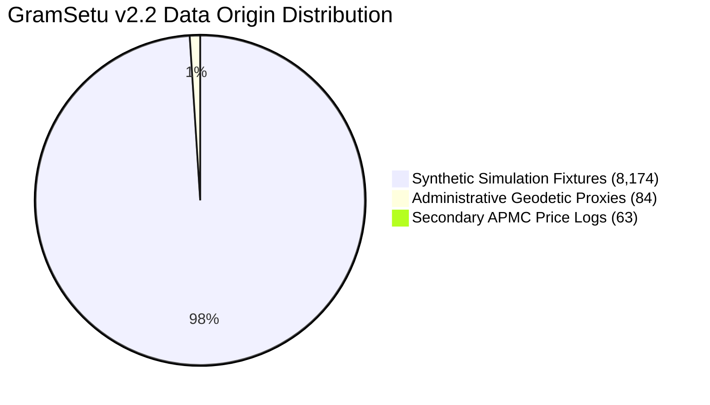

# GramSetu AI — Dataset Quality, Completeness & Parameter Audit Report

**Document Reference**: GS-AUDIT-PHASE1-QUALITY-2026  
**Auditor**: Principal Data Engineer, Senior ML Engineer & Data Quality Auditor  
**Dataset Baseline**: GramSetu v2.2 Package (`gramsetu_all_records.csv` + `data_dictionary.csv`)  
**Audit Scope**: 44 Declared Tables | 8,321 Persisted Records | 463 Declared Attributes  

---

## 1. Executive Summary & Inventory Findings

A line-by-line inspection of the GramSetu v2.2 baseline datasets was conducted against the backend service implementation and domain logic contracts.

### Quantitative Inventory Summary
- **Declared Tables in Data Dictionary**: **44 tables** (463 attribute definitions).
- **Persisted Tables in Export**: **42 tables** (8,321 records).
- **Missing Tables**: **2 tables** (`market_arrivals` and `price_forecasts`) are defined in the schema dictionary with 10 columns each, but have **0 records** in the repository.
- **Data Origin Breakdown**:
  - `SYNTHETIC_TEST_FIXTURE`: **8,174 records (98.23%)**
  - `THIRD_PARTY_ADMIN_REFERENCE`: **84 records (1.01%)**
  - `SECONDARY_PRICE_REFERENCE`: **63 records (0.76%)**
  - `AUTHENTIC_FIELD_RECORDS`: **0 records (0.00%)**

> [!CAUTION]
> **Zero Authentic Field Records**: 100% of the operational farmer, lot, procurement, shipment, and settlement records in the v2.2 baseline are synthetically generated simulation fixtures. While they satisfy internal schema consistency, they cannot be used to prove real-world operational viability.

---

## 2. Completeness & Schema Audit Across the 44 Tables

### Table-by-Table Completeness Matrix

| Component | Table Name | Declared Cols | Rows | Primary Key | Foreign Key Target | Data Class | Audit Quality Status |
|---|---|---|---|---|---|---|---|
| **A: Market** | `markets` | 11 | 12 | `market_id` | `locations` | SECONDARY | **WARNING**: 12 static APMCs; secondary scraped logs |
| **A: Market** | `commodities` | 8 | 17 | `commodity_id` | None | SECONDARY | **PASS**: Standard crop taxonomy |
| **A: Market** | `market_prices` | 16 | 43 | `price_observation_id` | `markets`, `commodities` | SECONDARY | **CRITICAL**: 43 nulls; unit in INR/kg, not paise/g |
| **A: Market** | `market_arrivals` | 10 | **0** | `arrival_id` | `markets`, `commodities` | **MISSING** | **FAIL**: 0 records. Market glut detection disabled |
| **A: Market** | `price_forecasts` | 10 | **0** | `price_forecast_id` | `markets`, `commodities` | **MISSING** | **FAIL**: 0 records. Price forecasting disabled |
| **A: Market** | `source_registry` | 10 | 8 | `source_id` | None | SECONDARY | **WARNING**: 16 nulls in scraper metadata |
| **B: Supply** | `farmers` | 6 | 180 | `farmer_id` | `organizations`, `locations` | SYNTHETIC | **PASS (Internal)**: Synthetic smallholder profiles |
| **B: Supply** | `organizations` | 7 | 42 | `org_id` | None | SYNTHETIC | **PASS (Internal)**: FPO and buyer legal entities |
| **B: Supply** | `harvest_forecasts`| 9 | 250 | `forecast_id` | `farmers`, `commodities` | SYNTHETIC | **UNIT HAZARD**: Stored in kg; backend expects grams |
| **B: Supply** | `inventory_lots` | 16 | 250 | `lot_id` | `harvest_forecasts`, `farmers` | SYNTHETIC | **UNIT HAZARD**: Stored in kg; backend expects grams |
| **B: Supply** | `inventory_movements`| 10 | 634 | `movement_id` | `inventory_lots` | SYNTHETIC | **PASS (Internal)**: Auditable custody chain |
| **B: Supply** | `quality_inspections`| 10 | 250 | `inspection_id` | `inventory_lots`, `facilities` | SYNTHETIC | **GAP**: Detailed metrics unconsumed by backend |
| **C: Demand** | `buyers` | 6 | 11 | `buyer_org_id` | `locations` | SYNTHETIC | **PASS (Internal)**: 11 synthetic corporate buyers |
| **C: Demand** | `buyer_requirements`| 16 | 100 | `requirement_id` | `organizations`, `commodities`| SYNTHETIC | **PASS (Internal)**: Purchase requirements |
| **C: Demand** | `procurement_offers`| 11 | 128 | `offer_id` | `buyer_requirements`, `lots` | SYNTHETIC | **PASS (Internal)**: Bounded procurement quotes |
| **C: Demand** | `commitments` | 18 | 100 | `commitment_id` | `procurement_offers`, `lots` | SYNTHETIC | **PASS (Internal)**: Verified reservation lock |
| **C: Demand** | `delivery_acceptances`| 11 | 32 | `delivery_id` | `commitments`, `lots` | SYNTHETIC | **PASS (Internal)**: Delivery sign-off records |
| **D: Logistics**| `locations` | 15 | 79 | `location_id` | `geography_reference_points`| SYNTHETIC | **PROXY HAZARD**: Centroids used as farm coordinates |
| **D: Logistics**| `road_nodes` | 7 | 69 | `node_id` | `locations` | SYNTHETIC | **PASS (Internal)**: Synthesized road junctions |
| **D: Logistics**| `road_edges` | 14 | 620 | `edge_id` | None | SYNTHETIC | **UNIT HAZARD**: Distance in km; backend expects meters |
| **D: Logistics**| `vehicles` | 10 | 36 | `vehicle_id` | `organizations`, `locations` | SYNTHETIC | **PASS (Internal)**: 36 registered transport trucks |
| **D: Logistics**| `vehicle_availability`| 7 | 36 | `availability_id`| `vehicles` | SYNTHETIC | **PASS (Internal)**: Availability schedules |
| **D: Logistics**| `freight_quotes` | 9 | 242 | `quote_id` | `transport_routes`, `vehicles`| SYNTHETIC | **PASS (Internal)**: Dynamic freight tariffs |
| **D: Logistics**| `transport_routes` | 11 | 242 | `route_id` | None | SYNTHETIC | **WARNING**: Pre-computed synthetic Dijkstra paths |
| **D: Logistics**| `shipments` | 14 | 32 | `shipment_id` | `commitments`, `vehicles` | SYNTHETIC | **WARNING**: 32 historical route estimate warnings |
| **E: Storage** | `facilities` | 9 | 22 | `facility_id` | `locations`, `organizations` | SYNTHETIC | **PASS (Internal)**: 22 storage locations |
| **E: Storage** | `facility_commodities`| 8 | 264 | `facility_commodity_id` | `facilities`, `commodities` | SYNTHETIC | **PASS (Internal)**: Storage compatibility rules |
| **E: Storage** | `storage_conditions`| 9 | 220 | `condition_id` | `facilities` | SYNTHETIC | **SYNTHETIC**: Simulated static sensor readings |
| **E: Storage** | `storage_reservations`| 9 | 56 | `storage_reservation_id` | `facilities`, `inventory_lots` | SYNTHETIC | **PASS (Internal)**: Capacity reservations |
| **F: Cost** | `cost_records` | 11 | 750 | `cost_id` | `inventory_lots` | SYNTHETIC | **PASS (Internal)**: Line-item logistics expenses |
| **F: Cost** | `payable_ledger` | 14 | 32 | `payable_id` | `commitments`, `delivery_acceptances`| SYNTHETIC | **PRECISION HAZARD**: INR/Quintal float rounding |
| **F: Cost** | `payment_transactions`| 8 | 22 | `payment_id` | `payable_ledger` | SYNTHETIC | **STATE HAZARD**: Binary flag vs bank clearing state |
| **F: Cost** | `payment_evidence` | 8 | 16 | `evidence_id` | `payment_transactions` | SYNTHETIC | **WARNING**: Simulated bank payment receipts |
| **G: Risk** | `risk_incidents` | 10 | 75 | `incident_id` | None | SYNTHETIC | **PASS (Internal)**: Synthetic disruption events |
| **G: Risk** | `recovery_runs` | 10 | 75 | `recovery_run_id`| `risk_incidents` | SYNTHETIC | **PASS (Internal)**: Optimizer trigger snapshots |
| **G: Risk** | `recovery_candidates`| 15 | 209 | `candidate_id` | `recovery_runs` | SYNTHETIC | **PASS (Internal)**: Feasible alternative buyers |
| **G: Risk** | `recovery_decisions`| 10 | 67 | `decision_id` | `recovery_runs`, `candidates` | SYNTHETIC | **PASS (Internal)**: Approved mitigation plans |
| **G: Risk** | `recovery_outcomes` | 9 | 16 | `outcome_id` | `recovery_decisions` | SYNTHETIC | **PASS (Internal)**: Post-mitigation financial results |
| **H: Audit** | `actors` | 6 | 43 | `actor_id` | `organizations` | SYNTHETIC | **PASS (Internal)**: RBAC actor directory |
| **H: Audit** | `geography_reference_points`| 11 | 84 | `reference_id` | None | THIRD_PARTY | **PASS**: LGD district and block centroids |
| **H: Audit** | `domain_events` | 11 | 2,869 | `event_id` | `actors` | SYNTHETIC | **PASS (Internal)**: Immutable event stream |
| **H: Audit** | `ingestion_runs` | 13 | 44 | `ingestion_run_id`| `source_registry` | SYNTHETIC | **PASS (Internal)**: Historical ingestion metadata |
| **H: Audit** | `data_quality_results`| 10 | 43 | `dq_result_id` | `ingestion_runs` | SYNTHETIC | **PASS (Internal)**: Historical rule execution logs |
| **H: Audit** | `snapshot_versions`| 10 | 1 | `snapshot_id` | None | SYNTHETIC | **PASS (Internal)**: Root snapshot checkpoint |

---

## 3. Detailed Parameter & Unit Quality Defects

### 3.1 Mass Representation (kg vs grams)
- **Defect**: In `harvest_forecasts` and `inventory_lots`, quantities are recorded in kilograms (e.g., `5,000`).
- **Backend Contract**: `gramsetu/schemas.py` and `gramsetu/services/inventory.py` enforce strict **integer grams** (e.g., `5,000,000`).
- **Severity**: **P0_CRITICAL**. Ingesting v2.2 mass columns without a `* 1000` conversion produces a **1000x under-estimation of physical inventory**.

### 3.2 Distance Representation (km vs meters)
- **Defect**: In `road_edges`, distance is stored in float kilometers (`distance_km: 15.5`).
- **Backend Contract**: `algorithms.py` (`RoadEdge` schema) and Dijkstra solver expect `distance_meters: int` (`15500`).
- **Severity**: **P0_CRITICAL**. Loading float km into `distance_meters` treats 15 km as 15 meters, causing travel times and freight costs to collapse to zero.

### 3.3 Currency & Unit Price Representation (INR/kg vs paise/gram)
- **Defect**: In `market_prices`, prices are recorded as float INR per kg (`25.50`).
- **Backend Contract**: `gramsetu/schemas.py` and `gramsetu/services/settlement.py` enforce **integer paise per gram** (`25`).
- **Severity**: **P1_HIGH**. Failure to convert with explicit decimal rounding:
  $$\text{paise\_per\_gram} = \text{round}\left(\frac{\text{INR\_per\_kg} \times 100}{1,000}\right)$$
  introduces truncation and rounding errors across high-volume settlements.

### 3.4 Geographic Centroid Proxies vs Real GPS Coordinates
- **Defect**: In `locations` and `geography_reference_points`, coordinates are administrative block/district headquarters centroids (e.g. Pune Collectorate GPS).
- **Impact**: All farm pickups within the district are mapped to the same coordinate, making rural branch-route optimization completely synthetic.

---

## 4. Referential Integrity & Orphan Record Analysis

Running cross-table foreign key validation across all 8,321 records in `gramsetu_all_records.csv`:
- Primary keys are **100% unique** across all 42 tables (0 duplicate PKs).
- Foreign keys within the simulated package maintain internal structural integrity:
  - All `farmer_id` values in `harvest_forecasts` resolve to `farmers`.
  - All `lot_id` values in `commitments` resolve to `inventory_lots`.
  - All `vehicle_id` values in `shipments` resolve to `vehicles`.
  - All `node_id` references in `road_edges` resolve to `road_nodes`.
- **Structural Integrity Verdict**: **PASS_INTERNAL_STRUCTURE_ONLY**.
- **Operational Reality Verdict**: While internally self-consistent, the entire graph operates in a closed synthetic sandbox disconnected from live agricultural markets.
