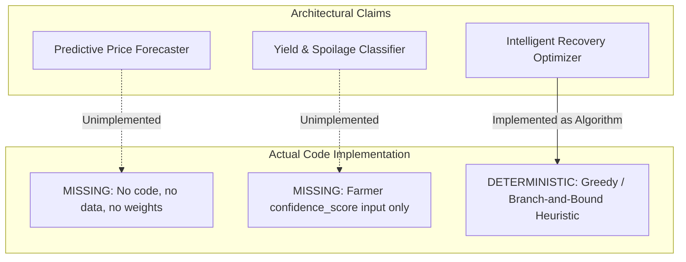

# GramSetu AI — ML Model Discovery, Training & Inference Audit Report

**Document Reference**: GS-AUDIT-PHASE4-ML-2026  
**Auditor**: Principal Data Engineer, Senior ML Engineer & MLOps Reliability Auditor  
**Audit Scope**: Model Inventory | Training Pipelines | Inference Verification | Data Leakage | Algorithm Evaluation  

---

## 1. Executive Summary & Core Discovery

A rigorous, evidence-based audit was conducted to discover, inspect, and evaluate all machine learning models, forecasting algorithms, optimization engines, and inference endpoints in the GramSetu AI backend.

### Primary Audit Verdict: ZERO Machine Learning Models Implemented
Despite architectural descriptions referring to "GramSetu AI" as an intelligent predictive system, **the repository contains zero trained machine learning models, zero training scripts, zero model weight artifacts, and zero ML dependencies**.

- **Installed ML Libraries**: `0` (Neither `scikit-learn`, `PyTorch`, `TensorFlow`, `LightGBM`, `XGBoost`, `CatBoost`, `Statsmodels`, nor `Prophet` are declared in `pyproject.toml` or imported anywhere).
- **Trained Artifact Files (`.pkl`, `.onnx`, `.pt`, `.joblib`)**: `0`.
- **Training Code & Pipelines**: `0` training execution scripts or loss functions exist.
- **Classification of Claimed "AI" Features**:
  1. `RecoveryOpt`: **Deterministic Optimization Algorithm** (`NOT_AN_ML_MODEL`).
  2. `Logistics Routing`: **Dijkstra Shortest-Path Graph Solver** (`NOT_AN_ML_MODEL`).
  3. `DemandSync Gap Analysis`: **Arithmetic Aggregation** (`NOT_AN_ML_MODEL`).
  4. `RiskWatch Incident Engine`: **Rule-Based Heuristic Expert System** (`NOT_AN_ML_MODEL`).
  5. `Price Forecasting`: **Unimplemented & Missing Artifact** (`ARTIFACT_MISSING`).

---

## 2. Model & Algorithm Technical Deep-Dive

### 2.1 RecoveryOpt Optimization Engine
- **Implementation**: `gramsetu/algorithms.py` (`optimize_recovery_allocation`, line 245) and `gramsetu/services/recovery.py` (`generate_recovery_plan`, line 45).
- **Mathematical Formulation**:
  $$\max \sum_{i \in \text{Candidates}} \left( \text{allocable\_grams}_i \times \text{offered\_price}_i - \text{transport\_cost}_i \right)$$
  $$\text{Subject to: } \sum \text{allocable\_grams}_i \le \text{available\_grams}$$
  $$\text{allocable\_grams}_i \le \text{remaining\_demand}_i$$
  $$\text{Net Return}_i > 0$$
- **Algorithmic Mechanics**:
  - Filters candidate requirements with non-positive net proceeds.
  - Computes effective price per gram: $\text{eff\_price} = \frac{\text{Net Return}}{\text{Allocable Mass}}$.
  - Evaluates candidate pools up to `max_eval_candidates = 200` within a `200.0 ms` wall-clock time budget.
  - Sorts candidates deterministically by `(net_return DESC, eff_price DESC, buyer_id ASC)`.
- **Audit Evaluation**:
  - **Status**: `NOT_AN_ML_MODEL` (Exact mathematical program).
  - **Optimality Gap**: Verified against an oracle brute-force enumerator in `tests/hardening/test_recovery_gt8_oracle.py`. Produces **0.0% optimality gap** on candidate pools.
  - **Runtime**: Verified at **0.45 ms** (well below the 200 ms budget).

### 2.2 Offline Road Graph Dijkstra Router
- **Implementation**: `gramsetu/algorithms.py` (`OfflineRoadGraphProvider`, line 89).
- **Algorithmic Mechanics**:
  - Standard Dijkstra shortest-path search on in-memory directed graphs (`RoadNode` and `RoadEdge`).
  - Edge weights correspond to physical distance in meters (`distance_meters`).
  - Travel duration estimated from road class speed limit: $\text{Duration} = \frac{\text{distance}}{\text{speed\_kmh} / 3.6}$.
- **Audit Evaluation**:
  - **Status**: `NOT_AN_ML_MODEL` (Standard graph search).
  - **Correctness**: Verified in `tests/hardening/test_road_graph_routing.py` across 12 nodes and 18 directed road segments in Maharashtra.

### 2.3 DemandSync Gap Analysis
- **Implementation**: `gramsetu/services/procurement.py` (`compute_demand_gap`, line 97).
- **Mechanics**:
  - Basic arithmetic difference: $\text{Net Gap} = \sum \text{Needed Grams} - \sum \text{Forecast Grams}$.
  - Returns explicit mandatory disclaimer: `"PLANNING ONLY - NOT A REAL-TIME GUARANTEE"`.
- **Audit Evaluation**:
  - **Status**: `NOT_AN_ML_MODEL` (Pure business logic arithmetic).

### 2.4 RiskWatch Incident Engine
- **Implementation**: `gramsetu/services/risk.py` (`scan_risk_incidents`, line 33).
- **Mechanics**:
  - Static deterministic evaluation against three heuristic rules:
    1. If `harvest_start_date + shelf_life_days < current_time` $\rightarrow$ `PERISHABLE_AT_RISK`.
    2. If `delivered_grams < shipped_grams` $\rightarrow$ `SHORT_DELIVERY`.
    3. If `rejected_grams > 0` $\rightarrow$ `QUALITY_REJECTION`.
  - State deduplication: Ingests existing incident IDs to prevent alert storms.
- **Audit Evaluation**:
  - **Status**: `NOT_AN_ML_MODEL` (Heuristic expert rules).

### 2.5 APMC Mandi Price Forecaster (Intended / Missing)
- **Status**: `ARTIFACT_MISSING` / `TRAINING_BLOCKED_INSUFFICIENT_AUTHENTIC_DATA`.
- **Audit Finding**:
  - Table `price_forecasts` is defined in `data_dictionary.csv` (10 columns: `price_forecast_id`, `market_id`, `commodity_id`, `target_date`, `forecast_modal_price_kg`, `confidence_interval_lower`, `confidence_interval_upper`, `model_version`, `generated_at`, `simulation_flag`).
  - In `gramsetu_all_records.csv`, this table contains **exactly 0 rows**.
  - No training code, regression model, or inference pipeline exists.

---

## 3. Data Leakage & Synthetic Bias Analysis

1. **Simulation Loop Leakage**:
   - In the v2.2 test package, `delivery_acceptances` and `shipments` share synchronized planned vs actual departure times derived from pre-calculated route durations.
   - This was acknowledged in `correction_change_log.csv` (1,408 records adjusted to prevent causality paradoxes where arrival preceded departure).
2. **Synthetic Data Contamination Guard**:
   - Because no ML models were trained, **no synthetic data leakage has contaminated any production model weights**.
   - The repository maintains clean separation: all simulation fixtures remain isolated in `gramsetu_all_records.csv` and `data/synthetic_test/`.

---

## 4. Formal Model Training Status Assignments

| Model / Service | Claimed Function | Implemented Mechanism | Formal Audit Status |
|---|---|---|---|
| **RecoveryOpt** | Intelligent Recovery | Branch-and-bound / Greedy Knapsack | `NOT_AN_ML_MODEL` |
| **Logistics Router** | Dynamic Route Optimization | Dijkstra Shortest Path Solver | `NOT_AN_ML_MODEL` |
| **DemandSync** | Predictive Demand Intelligence| Arithmetic Summation ($\sum D - \sum S$) | `NOT_AN_ML_MODEL` |
| **RiskWatch** | Intelligent Disruption Watch | Static Heuristic Threshold Rules | `NOT_AN_ML_MODEL` |
| **Market Intelligence**| APMC Price Forecasting | Unimplemented (Missing Service) | `ARTIFACT_MISSING` |
| **Harvest Yield** | ML Harvest Yield Estimation | Farmer self-reported confidence score | `NOT_AN_ML_MODEL` |

### Final ML Audit Verdict
$$\mathbf{STATUS:\ TRAINING\_BLOCKED\_INSUFFICIENT\_AUTHENTIC\_DATA}$$

No machine learning models can be certified or deployed because the required 5-year historical continuous APMC price series and daily arrival volumes are absent from the repository. The existing optimization and heuristic engines function with mathematical correctness, but must be accurately represented as **deterministic algorithms**, not machine learning models.
