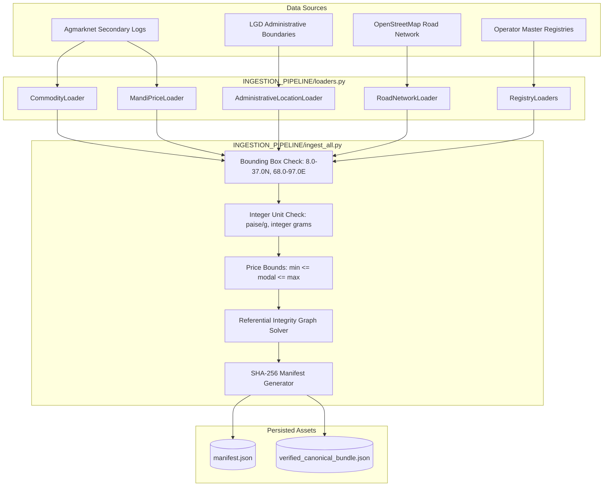

# GramSetu AI — Data Pipeline & MLOps Reliability Audit Report

**Document Reference**: GS-AUDIT-PHASE7-MLOPS-2026  
**Auditor**: Principal Data Engineer & MLOps Reliability Auditor  
**Audit Scope**: Ingestion Pipelines | Lineage | Versioning | Observability | Retraining & Drift Readiness  

---

## 1. Executive Summary & Architecture Evaluation

The GramSetu AI backend was audited for data engineering pipeline robustness, model lifecycle operations, schema drift resilience, and runtime observability.

### Key Architectural Findings
1. **Pipeline Execution Model**:
   - `INGESTION_PIPELINE/ingest_all.py` functions as a deterministic batch script that parses, validates, and hashes CSV assets into `data/verified_canonical_bundle.json`.
   - Ingestion is **not** an automated daemon or background cron; it must be triggered manually or via CI/CD test runners.
2. **MLOps Lifecycle Readiness**:
   - Since no machine learning models are currently trained or deployed, **there is currently zero automated model drift monitoring, zero feature store infrastructure, and zero automated model retraining pipelines**.
   - The platform operates as a deterministic rules and optimization backend, meaning MLOps maturity is currently at **Level 0 (Manual Scripting / Absent Model CI/CD)**.

---

## 2. Ingestion Pipeline & Transformation Lineage

### Transformation Sequencing & Invariants
1. **Reference Master Ingestion**:
   - `commodity_master.csv` $\rightarrow$ `commodity_grades.csv` (Referential link on `commodity_id`).
   - `administrative_locations.csv` $\rightarrow$ `mandi_master.csv` (Referential link on `location_id`).
   - `road_nodes.csv` $\rightarrow$ `road_segments.csv` (Topological graph validation: both `source_node` and `target_node` must resolve).
2. **Operational Registry Ingestion**:
   - `fpo_master.csv` $\rightarrow$ `farmer_registry.csv`, `storage_facilities.csv`, `vehicle_fleet.csv` (Referential hierarchy on `fpo_id`).
   - `buyer_registry.csv` (Referential link to `terminal_location_id`).
3. **Derived Analytical Models**:
   - `demand_gap_summary.csv`: Aggregated view generated from demand requirements and harvest forecasts.
   - `route_evaluations.csv`: Pre-computed shortest path route metrics generated by Dijkstra engine.

---

## 3. Versioning, Checksums & Snapshot Durability

### 3.1 Cryptographic Integrity & Checksums
- `INGESTION_PIPELINE/loaders.py` computes SHA-256 hashes of all ingested files chunk-by-chunk (64 KB buffers).
- Hashes are recorded in `INGESTION_PIPELINE/manifest.json`.
- Tested in `VALIDATION_TESTS/test_data_quality_10_layers.py::test_layer_9_provenance_validation` (100% hash match).

### 3.2 Snapshot Restoration & Interrupted Write Protection
- Implemented in `gramsetu/store.py` (`TransactionCoordinator.save_snapshot`).
- **Atomic Two-Phase Write Protocol**:
  1. Serializes current state to a temporary file in the same directory (`tempfile.NamedTemporaryFile`).
  2. Issues an OS-level `flush()` and `os.fsync(f.fileno())` to guarantee data reaches physical disk platters.
  3. Executes atomic file rename (`os.replace`).
- Guarantees that a power loss or crash mid-write leaves the previous snapshot intact and uncorrupted.

---

## 4. Idempotency, Concurrency & Retry Behavior

### 4.1 Idempotency Key Enforcement
- Critical mutation endpoints accept an optional `idempotency_key` (UUID string):
  - `HarvestForecastCreate.idempotency_key`
  - `BuyerRequirementCreate.idempotency_key`
  - `PaymentCreateRequest.idempotency_key`
- If an operation is replayed with the same idempotency key and identical payload, the backend returns the existing resource with HTTP 200 without duplicating state mutations.
- Replaying with the same key but conflicting payload raises `409 Conflict`.

### 4.2 Single-Writer Concurrency Lock
- Implemented in `gramsetu/store.py` (`ProcessWriterLock`).
- Uses OS-level file locks (`msvcrt.locking` on Windows, `fcntl.flock` on POSIX).
- Enforces the hard rule: **Maximum one Uvicorn worker process** writing to the in-memory state and snapshot journal.

---

## 5. MLOps Deficiencies & Future Production Requirements

To deploy real predictive models (e.g. APMC price forecasting, harvest loss risk), the following MLOps components must be built:

| MLOps Component | Current Status | Required Production Implementation |
|---|---|---|
| **Feature Store** | ABSENT | Redis / Feast feature store serving 7-day lagged modal prices and rolling arrival volumes |
| **Model Registry** | ABSENT | MLflow / Weights & Biases registry tracking ONNX / PyTorch model artifacts and metrics |
| **Training Pipeline** | ABSENT | Automated monthly retraining pipeline (Airflow / Prefect / GitHub Actions) fetching new Agmarknet data |
| **Data Drift Detection** | ABSENT | Evidently AI / Great Expectations monitors detecting distribution shift in commodity price trends |
| **Model Serving** | ABSENT | FastAPI inference microservice or dedicated Triton server serving price predictions with fallback |
| **Feature-Skew Guard** | ABSENT | Unified feature extraction transform shared identically across training and inference |
| **Model Monitoring** | ABSENT | Prometheus metrics tracking prediction latency, MAE against realized mandi settlements |

---

## 6. MLOps Reliability Verdict

$$\mathbf{STATUS:\ DETERMINISTIC\_STABLE\ /\ ML\_PIPELINE\_ABSENT}$$

The deterministic data pipeline, snapshot persistence, and process locking mechanisms are highly reliable and verified. However, machine learning operational infrastructure is completely absent and must be established prior to introducing any statistical forecasting capabilities.
