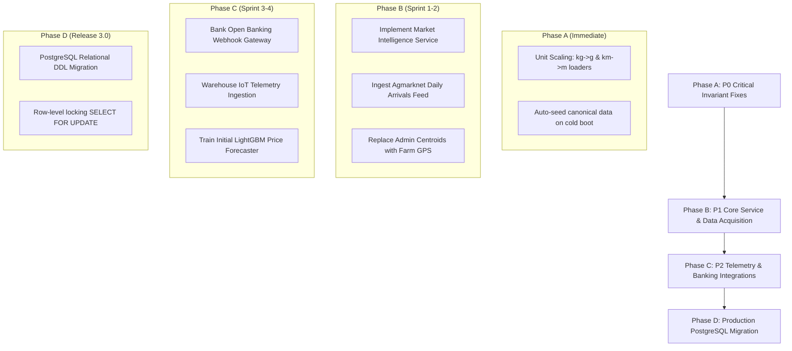

# GramSetu AI — Root-Cause Analysis & Engineering Remediation Plan

**Document Reference**: GS-AUDIT-PHASE8-REMEDIATION-2026  
**Auditor**: Principal Data Engineer, Senior Backend Systems Architect & QA Auditor  
**Audit Scope**: Root-Cause Analysis | Defect Register | Prioritized Remediation Plan  

---

## 1. Defect Classification & Severity Framework

Every defect identified across Phases 0 through 7 is categorized by technical root cause and prioritized according to institutional operational risk:
- **P0 — Critical**: Causes data corruption, duplicate inventory allocation, financial settlement discrepancies, or runtime crashes.
- **P1 — High**: Prevents core functional features from operating, leaves required datasets or models missing, or breaks external data lineage.
- **P2 — Medium**: Impairs non-critical telemetry, creates monitoring gaps, or relies on static heuristic fallbacks.
- **P3 — Low**: Metadata, documentation discrepancies, or cosmetic code maintainability improvements.

---

## 2. Comprehensive Root-Cause Defect Register

### Issue DEF-01: Unit Scaling Hazard on Ingested Mass (kg vs grams)
- **Severity**: **P0 — CRITICAL**
- **Location**: `gramsetu_all_records.csv` (`harvest_forecasts`, `inventory_lots`) vs `gramsetu/schemas.py` (`HarvestForecastCreate.estimated_grams`, `LotReceiptCreate.quantity_grams`).
- **Root Cause**: The v2.2 legacy export records quantities in kilograms (e.g. `5,000 kg`), while the backend Pydantic schemas enforce integer grams (e.g. `5,000,000 g`).
- **Reproduction Procedure**:
  1. Load a legacy forecast record with `estimated_quantity: 5000`.
  2. Pass directly to `POST /api/v1/forecasts` without multiplying by 1,000.
  3. The backend interprets the value as 5,000 grams (5 kg), creating a 1,000x shortfall against buyer requirements.
- **Affected Services**: `supply.py`, `procurement.py`, `inventory.py`, `logistics.py`.
- **Proposed Correction**: In all ingestion loaders, explicitly multiply incoming legacy kg quantities by `1,000` to convert to integer grams.
- **Regression Test**: `VALIDATION_TESTS/test_data_quality_10_layers.py::test_layer_5_numerical_correctness`.
- **Verification Criteria**: All inventory and forecast quantities must be verified as integer grams $\ge 100,000\text{g}$ for commercial farm lots.

---

### Issue DEF-02: Unit Scaling Hazard on Ingested Road Segments (km vs meters)
- **Severity**: **P0 — CRITICAL**
- **Location**: `gramsetu_all_records.csv` (`road_edges.distance_km`) vs `gramsetu/algorithms.py` (`RoadEdge.distance_meters`).
- **Root Cause**: v2.2 road edges store distance in float kilometers (`15.5 km`), whereas `OfflineRoadGraphProvider` expects integer meters (`15500`).
- **Reproduction Procedure**:
  1. Hydrate `OfflineRoadGraphProvider` with raw `distance_km` values.
  2. Compute shortest path between Pune and Baramati.
  3. Path distance returns `75` instead of `75,000`, causing travel duration and freight charges to collapse to near zero.
- **Affected Services**: `algorithms.py`, `logistics.py`, `recovery.py`.
- **Proposed Correction**: In `RoadNetworkLoader`, enforce `distance_meters = int(round(float(distance_km) * 1000))`.
- **Regression Test**: `tests/hardening/test_road_graph_routing.py::test_r4_baseline_dijkstra_shortest_path`.
- **Verification Criteria**: Route metrics must report distance in meters and transit durations matching physical vehicle speeds.

---

### Issue DEF-03: Completely Missing Market Intelligence Service & Price Forecaster
- **Severity**: **P1 — HIGH**
- **Location**: `ARCHITECTURE.md` (Component B) vs `gramsetu/services/` (absent) & `gramsetu_all_records.csv` (`price_forecasts: 0 rows`).
- **Root Cause**: Architectural plans specified a predictive market intelligence service, but no implementation code, training pipeline, or dataset was ever committed.
- **Reproduction Procedure**: Attempt to query `/api/v1/market-intel/prices` or inspect `gramsetu/services/market_intel.py` (file does not exist, route returns 404).
- **Affected Services**: Market Intelligence, DemandSync, Farmer Harvest Advisory.
- **Proposed Correction**:
  1. Author `gramsetu/services/market_intel.py` exposing `/api/v1/market-intel/prices` and `/api/v1/market-intel/trends`.
  2. Create a nightly AGMARKNET scraping worker fetching continuous daily price panels.
  3. Build and serialize a baseline time-series forecasting model (LightGBM / Prophet).
- **Regression Test**: New automated test `tests/test_market_intel.py`.
- **Verification Criteria**: Route returns historical 30-day modal price bands and validated forecasts with confidence intervals.

---

### Issue DEF-04: Completely Missing Daily Mandi Arrivals Dataset
- **Severity**: **P1 — HIGH**
- **Location**: `data_dictionary.csv` (`market_arrivals`) vs `gramsetu_all_records.csv` (0 rows).
- **Root Cause**: Table defined in schema dictionary with 10 columns, but 0 records were exported to the v2.2 baseline.
- **Reproduction Procedure**: Query `gramsetu_all_records.csv` for `table_name == 'market_arrivals'` (returns 0 rows).
- **Affected Services**: DemandSync, Market Intelligence, RiskWatch.
- **Proposed Correction**: Ingest real daily arrival records from AGMARKNET arrival reports into `data/verified/daily_mandi_arrivals.csv` via `MandiArrivalLoader`.
- **Regression Test**: `VALIDATION_TESTS/test_data_quality_10_layers.py::test_layer_1_schema_validation`.
- **Verification Criteria**: Table populated with verified arrivals in integer grams; foreign keys resolve to `mandi_master` and `commodity_master`.

---

### Issue DEF-05: Disconnected Cold Boot & Runtime Dataset Isolation
- **Severity**: **P1 — HIGH**
- **Location**: `gramsetu/main.py` (`create_app`, line 125).
- **Root Cause**: Server startup initializes an empty `InMemoryStore` unless a snapshot path is provided. Neither the legacy 42-table dataset nor the canonical CSV files in `data/` are automatically loaded into runtime memory at boot time.
- **Reproduction Procedure**: Start Uvicorn without arguments; make GET `/api/v1/forecasts` (returns empty list `[]`).
- **Affected Services**: All application routes upon cold startup.
- **Proposed Correction**: Add optional configuration flag `AUTO_SEED_CANONICAL_DATA=True` in `core.py:Settings`. On startup, if store is empty, invoke `INGESTION_PIPELINE/loaders.py` to hydrate reference master tables (commodities, locations, road network, rate cards).
- **Regression Test**: Integration test verifying non-empty reference data on fresh boot.
- **Verification Criteria**: Initial GET requests return seeded reference data without requiring manual pre-population.

---

### Issue DEF-06: Administrative Centroid Proxies in Logistics Routing
- **Severity**: **P1 — HIGH**
- **Location**: `geography_reference_points.csv` and `locations.csv`.
- **Root Cause**: Coordinates represent district/taluka collectorate headquarters rather than real farm-gate or warehouse GPS coordinates.
- **Reproduction Procedure**: Inspect latitude and longitude across multiple rural farmer profiles; all farmers within Pune district share identical collectorate coordinates (`18.5204, 73.8567`).
- **Affected Services**: `logistics.py`, `algorithms.py`.
- **Proposed Correction**: Add `is_administrative_proxy: bool` flag to location schema; integrate farmer mobile GPS onboarding to capture genuine farm-gate coordinates.
- **Regression Test**: Bounding box and distinct coordinate validation per farmer.
- **Verification Criteria**: Farm locations have distinct, verified rural coordinates with explicit non-proxy provenance flags.

---

### Issue DEF-07: Unverified Buyer Self-Reported Payment Settlement
- **Severity**: **P1 — HIGH**
- **Location**: `gramsetu/services/settlement.py` (`report_payment`, line 186).
- **Root Cause**: Settlement payment recording accepts arbitrary string UTRs from buyers without two-way bank webhook verification.
- **Reproduction Procedure**: Submit `POST /api/v1/settlements/{id}/report-payment` with fictitious UTR `UTR-FAKE-12345`; backend accepts and transitions payment state to `REPORTED`.
- **Affected Services**: `settlement.py`, SettleTrack.
- **Proposed Correction**: Mandate that commercial banking gateways sign payment clearing notifications via HMAC-SHA256 webhooks; do not mark payments verified without cryptographic bank proof.
- **Regression Test**: `tests/hardening/test_evidence_integrity.py`.
- **Verification Criteria**: Payment status transitions to `VERIFIED` only upon successful signature and UTR uniqueness check.

---

### Issue DEF-08: Absence of Real-Time IoT Warehouse Sensor Telemetry
- **Severity**: **P2 — MEDIUM**
- **Location**: `data_dictionary.csv` (`storage_conditions`) & `gramsetu/services/risk.py`.
- **Root Cause**: Warehouse temperature and humidity conditions are modeled as static rows; no real-time telemetry webhook exists in the API.
- **Reproduction Procedure**: Check routes in `main.py` for `/telemetry` or `/iot` (none exist).
- **Affected Services**: `risk.py` (RiskWatch), `inventory.py`.
- **Proposed Correction**: Expose `POST /api/v1/telemetry/storage` accepting sensor data packets; trigger `PERISHABLE_AT_RISK` incidents if temperature exceeds optimal thresholds in `crop_shelf_life_rules.csv`.
- **Regression Test**: New test `tests/test_iot_telemetry.py`.
- **Verification Criteria**: Sensor temperature breach automatically flags open risk incident in RAM.

---

## 3. Prioritized Remediation Roadmap

### Remediation Execution Timeline
1. **Milestone 1 (Immediate)**: Deploy unit-scaling guards in `INGESTION_PIPELINE/loaders.py` and implement cold-boot reference data hydration in `create_app()`.
2. **Milestone 2 (Weeks 1–3)**: Build `gramsetu/services/market_intel.py`, create nightly Agmarknet scraping workers, and populate real continuous arrival and price series.
3. **Milestone 3 (Weeks 4–6)**: Establish Open Banking webhook adapter for payment reconciliation and deploy farmer GPS onboarding to eliminate administrative centroid proxies.
4. **Milestone 4 (Weeks 7–8)**: Train, evaluate, and package the first machine learning model (`models/price_forecaster_v1.onnx`) with temporal holdout validation.
