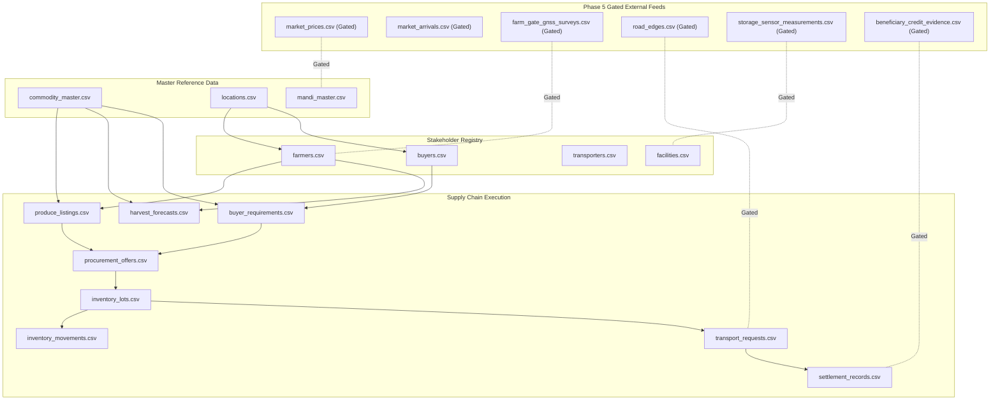

# GramSetu AI — Comprehensive Dataset Requirements & Architecture Report

**Document Title**: GramSetu System-Wide Dataset Requirements, Schema Specifications, and Pilot Collection Architecture  
**Filename**: `GRAMSETU_DATASET_REQUIREMENTS_REPORT.md`  
**System Version**: GramSetu 2.2.0 (Rural Food Supply Chain Resilience Platform)  
**Target Pilot Context**: Rural West Bengal Agricultural Corridor (Hooghly, Purba Bardhaman, Nadia)  
**Date of Audit**: November 2026  
**Auditor**: Senior Full-Stack Database Architect, Security Engineer & Systems Auditor  

---

## 1. Executive Summary

GramSetu is an AI-powered smart rural food supply chain management platform architected to empower smallholder farmers, Farmer Producer Organizations (FPOs), institutional wholesale buyers, rural logistics operators, and cold storage facilities. The platform automates crop listing discovery, demand-supply matching (DemandSync), shared transport route bin-packing, shelf-life spoilage tracking, immutable lot custody (BatchTrace), bilateral forward procurement agreements (CommitGuard), transparent financial disbursement (SettleTrack), proactive disruption alerting (RiskWatch), distressed crop salvage (RecoveryOpt), and zero-literacy multilingual voice access.

This comprehensive audit report establishes the authoritative data blueprint for GramSetu. It details every operational, external, and future dataset required by the platform across all 15 operational sub-modules. In strict compliance with Phase 5/6 data acceptance gates:
- **No synthetic, mock, or fabricated records** are generated to fill unverified gaps.
- Blocked datasets (historical market panels, farm gate GPS surveys, road passability graphs, carrier freight quotes, calibrated IoT sensor streams, and bank clearing confirmations) remain **strictly unpopulated and gated** until authentic primary evidence is uploaded and cryptographically validated.
- This report defines exact schema specifications, validation invariants, source recommendations, partner verification protocols, and a pragmatic field data collection strategy for an initial pilot in rural West Bengal.

---

## 2. GramSetu Architecture and Data Dependency Overview

GramSetu operates on a multi-tier architecture where core domain workflows enforce strict mathematical and cryptographic invariants:
1. **Mass Conservation Invariant**: Physical lot transformations (splits, merges, and delivery receipts) must satisfy:
   $$\text{total\_grams} = \text{available\_grams} + \text{reserved\_grams}$$
   $$\text{accepted\_grams} + \text{rejected\_grams} + \text{transit\_loss\_grams} = \text{dispatched\_grams}$$
2. **Financial Precision Invariant**: All monetary values are maintained in integer paise ($1\text{ INR} = 100\text{ paise}$) with explicit Half-Up decimal rounding to prevent floating-point drift:
   $$\text{gross\_paise} - (\text{fpo\_commission\_paise} + \text{logistics\_fee\_paise}) = \text{net\_farmer\_amount\_paise}$$
3. **Evidence Authenticity Invariant**: Every external custody receipt, payment reference, or weighment must produce an immutable SHA-256 payload digest.

The system partitions data into three primary operational classes:
- **Application-Generated Records**: User accounts, crop listings, procurement offers, transport requests, and recovery plans created directly through the user interface and API workflows.
- **Master Reference Datasets**: Administrative geography (LGD codes), commodity standards (AGMARK/BIS), and mandi master records ingested from authoritative government registries.
- **External Partner Evidence & Sensor Streams**: Calibrated IoT cold storage telemetry, weighbridge receipts, GNSS ground surveys, and bank settlement confirmations provided by third-party partners.

---

## 3. Dataset Status Overview

Below is the consolidated master status table of all 28 identified GramSetu datasets across the entire platform.

| Dataset Name | Suggested Filename | Related Module | Priority | Current Status | Recommended Source | Verification Required |
|---|---|---|---|---|---|---|
| Commodity Master | `commodity_master.csv` | DemandSync / Catalog | High | AVAILABLE (Core Baseline) | Agmarknet / AGMARK | Official Government Standard |
| Commodity Grades | `commodity_grades.csv` | BatchTrace / Quality | High | AVAILABLE (Core Baseline) | BIS / AGMARK Standards | Official Specification |
| Mandi Master Directory | `mandi_master.csv` | Market Intelligence | High | AVAILABLE (Baseline) | DMI / eNAM / State APMC | Official Directory Match |
| Administrative Locations | `locations.csv` | Logistics / Admin | High | AVAILABLE (Census/LGD) | Local Government Directory (LGD) | Government Crosswalk Approval |
| Farmer Registry | `farmers.csv` | Farmer Onboarding | Critical | APPLICATION GENERATED | GramSetu App / State Revenue | Self-Declared + FPO Verification |
| Buyer Network Registry | `buyers.csv` | Procurement / KYC | Critical | APPLICATION GENERATED | GramSetu App / GSTN | GSTIN / Trade License Verification |
| Produce Listings Catalog | `produce_listings.csv` | Marketplace | Critical | APPLICATION GENERATED | Farmer / FPO Entry | FPO Lot Custody Verification |
| Harvest Yield Forecasts | `harvest_forecasts.csv` | DemandSync | High | APPLICATION GENERATED | Farmer App / Field Officer | FPO Cluster Aggregation |
| Buyer Demand Requirements | `buyer_requirements.csv` | DemandSync | High | APPLICATION GENERATED | Wholesale Buyer Entry | Buyer Commercial Commitment |
| Bilateral Procurement Offers | `procurement_offers.csv` | CommitGuard | Critical | APPLICATION GENERATED | Direct Buyer Bid Workflow | Bilateral Digital Acceptance |
| Transporters & Fleet | `transporters.csv` | Shared Logistics | High | APPLICATION GENERATED | Transport Fleet Operator | Vehicle Registration & Insurance |
| Carrier Vehicles | `vehicles.csv` | Shared Logistics | High | APPLICATION GENERATED | Transporter Entry | VAHAN Registration Check |
| Transport Requests | `transport_requests.csv` | Shared Logistics | High | APPLICATION GENERATED | Farmer / FPO Dispatch Request | FPO Gate Verification |
| Storage Facilities Master | `facilities.csv` | Storage & Spoilage | High | APPLICATION GENERATED | Storage Operator Entry | WDRA / FSSA License Verification |
| Inventory Lots & Batches | `inventory_lots.csv` | BatchTrace / Inventory | Critical | APPLICATION GENERATED | Warehouse Receipt Workflow | Certified Physical Weighment |
| Inventory Movements | `inventory_movements.csv` | BatchTrace | Critical | APPLICATION GENERATED | Custody Handover Handshake | Driver & Operator Signed Handover |
| Settlement Ledgers | `settlement_records.csv` | SettleTrack | Critical | APPLICATION GENERATED | Automated Post-Delivery Ledger | FPO Accounting Clearance |
| Supply Chain Risk Incidents | `risk_incidents.csv` | RiskWatch | High | APPLICATION GENERATED | Algorithmic Risk Scanner | Local Field Report Confirmation |
| Distressed Recovery Plans | `recovery_plans.csv` | RecoveryOpt | High | APPLICATION GENERATED | Combinatorial Salvage Solver | 2-Step FPO & Buyer Approval |
| Historical Market Prices Panel | `market_prices.csv` | Market Intel / ML | High | **BLOCKED (Gate P5-A01/A02)** | Agmarknet (DMI) Primary Feed | $\ge 730$-Day History, $\ge 80\%$ Coverage |
| Daily Market Arrivals Feed | `market_arrivals.csv` | Market Intel | High | **BLOCKED (Gate P5-A04)** | State APMC Daily Yard Logs | Daily Authenticated Mandi Slips |
| Market Crosswalk Approvals | `official_crosswalk_approvals.csv`| Market Intel | High | **BLOCKED (Gate P5-A03)** | State Agri Marketing Board | Official Joint Mapping Approval |
| Farm-Gate GNSS Surveys | `farm_gate_gnss_surveys.csv` | Logistics / Geo | Medium | **BLOCKED (Gate P5-G02)** | On-Site Differential GPS Survey | Surveyor Device Calibration Certificate |
| Road Routing Topology | `road_nodes.csv` & `road_edges.csv` | Logistics Routing | Medium | **BLOCKED (Gate P5-G03)** | PWD / PMGSY Survey / OSM Verified | Official Road Passability Audit |
| Road Segment Restrictions | `road_segment_restriction_evidence.csv` | Logistics Routing | Medium | **BLOCKED (Gate P5-G03)** | District Magistrate / PWD Notices | Official Traffic / Weight Notice |
| Calibrated Storage IoT Telemetry | `storage_sensor_measurements.csv` | Storage / Spoilage | High | **BLOCKED (Gate P5-O02)** | Calibrated IoT Telemetry Streams | NABL Calibration Certificate |
| Beneficiary Bank Credit Evidence | `beneficiary_credit_evidence.csv`| SettleTrack | Critical | **BLOCKED (Gate P5-F01)** | Scheduled Commercial Bank API / UTR | Authoritative Bank Gateway Callback |
| Real-Time Weather Warning Alerts | `imd_weather_warning_evidence.csv`| RiskWatch | Medium | **BLOCKED (Gate P5-R02)** | IMD District Agromet Bulletins | Signed IMD API Stream / CAP Alert |

---

## 4. Required Datasets by Module

### 4.1 Farmers Directory & Harvest Forecasts
- **Primary Modules**: Farmers, DemandSync
- **Operational Role**: Captures smallholder producer profiles, geographic administrative cluster, landholding acreage, crop varieties sown, language preference, and forward yield forecasts.
- **Dependency**: Feeds into DemandSync supply aggregation and BatchTrace lot origin tracking.

### 4.2 Buyer Network & Demand Requirements
- **Primary Modules**: Buyers, DemandSync, CommitGuard
- **Operational Role**: Maintains verified wholesale buyers, institutional aggregators, and food processors with delivery requirements (target quantity, max budget, delivery district, delivery deadline).
- **Dependency**: Directly matched against farmer harvest forecasts to detect surplus/deficit gaps.

### 4.3 Produce Catalog & Listings
- **Primary Modules**: Listings, CommitGuard
- **Operational Role**: Enables farmers and FPOs to list available produce lots with transparent asking prices in ₹/kg (paise precision), quality grade, harvest dates, and available-from windows.
- **Dependency**: Acts as the foundation for buyer procurement offers and forward contracts.

### 4.4 Market Intelligence & Price Benchmarks
- **Primary Modules**: Market Intelligence, ML Forecasting
- **Operational Role**: Compares authentic mandi modal prices against direct buyer farm-gate contracts. Displays net farmer realizations deducting mandi cesses and freight fees.
- **Dependency**: Requires historical series ($\ge 730$ days) for machine learning price forecasting. Currently operates in authentic baseline mode due to Phase 5 gates.

### 4.5 DemandSync
- **Primary Modules**: DemandSync
- **Operational Role**: Algorithmic supply-demand reconciliation engine calculating net volume gaps ($\text{Supply} - \text{Demand}$) by commodity and district.
- **Dependency**: Requires `harvest_forecasts` and `buyer_requirements`.

### 4.6 Shared Logistics & Pooling
- **Primary Modules**: Logistics
- **Operational Role**: Solves greedy multi-farmer vehicle cargo bin-packing to pool smallholder lots into high-capacity vehicles, minimizing empty-run deadhead kilometers.
- **Dependency**: Depends on `transport_requests`, `vehicles`, and `transporters`. Operates on district centroid approximations while GNSS surveys are blocked.

### 4.7 Storage Facilities & Spoilage Monitoring
- **Primary Modules**: Storage & Spoilage
- **Operational Role**: Tracks cold storage and dry warehouse capacity utilization, shelf-life elapsed days, and agronomic decay curves.
- **Dependency**: Uses crop baseline shelf-life formulas. Live IoT sensor streams remain blocked pending partner calibration.

### 4.8 BatchTrace & Custody Audit
- **Primary Modules**: Traceability
- **Operational Role**: Emits immutable chronological custody transfer events from farm gate to FPO intake, vehicle transit, cold storage, and buyer receipt.
- **Dependency**: Each milestone carries an explicit verification badge (`AUTHENTIC`, `PROVISIONAL`, `UNVERIFIED`).

### 4.9 CommitGuard & Procurement Offers
- **Primary Modules**: Procurement
- **Operational Role**: Bilateral contract workflow allowing buyers to bid on crop listings. Enforces floor pricing and stock reservation upon acceptance.
- **Dependency**: Automatically triggers SettleTrack ledger voucher generation upon delivery.

### 4.10 SettleTrack & Financial Ledgers
- **Primary Modules**: Settlements
- **Operational Role**: Financial disbursement ledger calculating net payouts after FPO service commissions and logistics fees.
- **Dependency**: Tracks recorded UTR references. Live bank API confirmation remains gated.

### 4.11 RiskWatch
- **Primary Modules**: RiskWatch
- **Operational Role**: Algorithmic risk scanner detecting supply chain vulnerabilities (storage capacity alarms, road bottlenecks, transit delays).
- **Dependency**: Live IMD district feed remains gated; currently runs on verified local operational incidents.

### 4.12 RecoveryOpt
- **Primary Modules**: Recovery
- **Operational Role**: Combinatorial salvage optimizer ranking alternative buyers (food processors, bulk dehydrators, cattle feed units) to salvage up to 80% economic value from distressed perishable lots.
- **Dependency**: Formulates salvage recovery plans requiring two-step approval (FPO Admin + Buyer).

### 4.13 AI Multilingual Voice Assistant
- **Primary Modules**: Voice AI
- **Operational Role**: Multilingual accessibility interface supporting Bengali (`bn-IN`), Hindi (`hi-IN`), and English (`en-IN`).
- **Dependency**: Maps spoken or typed queries to internal domain service intents using localized vocabulary.

---

## 5. Dataset Schema Specifications

### 5.1 `commodity_master.csv` (Commodity Master Reference)
| Column Name | Data Type | Required | Description | Validation Rule | Unit |
|---|---|---|---|---|---|
| `commodity_id` | String | Yes | Unique functional identifier | Regex: `^CMD-[A-Z0-9]{4,8}$` | None |
| `commodity_name` | String | Yes | Common name in English | Titlecase, min 2 chars | None |
| `scientific_name` | String | No | Botanical binomial name | Text | None |
| `category` | String | Yes | Agricultural category | Enum: `CEREALS`, `VEGETABLES`, `FRUITS`, `FIBRES` | None |
| `hsn_code` | String | Yes | Harmonized System Nomenclature code | Regex: `^[0-9]{4,8}$` | None |
| `standard_moisture_max_pct` | Float | Yes | Maximum permissible moisture percentage | Range: `5.0` to `25.0` | % |
| `default_shelf_life_days` | Integer | Yes | Ambient shelf life in days | Range: `1` to `365` | Days |
| `is_perishable` | Boolean | Yes | Flag indicating high perishability | `true` or `false` | None |

### 5.2 `commodity_grades.csv` (Quality Grading Specifications)
| Column Name | Data Type | Required | Description | Validation Rule | Unit |
|---|---|---|---|---|---|
| `grade_id` | String | Yes | Unique grade identifier | Regex: `^GRD-[A-Z0-9-]{4,12}$` | None |
| `commodity_id` | String | Yes | Foreign key to `commodity_master` | Must exist in `commodity_master` | None |
| `grade_code` | String | Yes | Commercial grade code | Enum: `'A'`, `'B'`, `'C'`, `'FAQ'` | None |
| `min_purity_pct` | Float | Yes | Minimum varietal purity | Range: `80.0` to `100.0` | % |
| `max_foreign_matter_pct` | Float | Yes | Maximum foreign matter allowed | Range: `0.0` to `10.0` | % |
| `max_moisture_pct` | Float | Yes | Maximum allowable moisture for grade | Range: `5.0` to `20.0` | % |

### 5.3 `mandi_master.csv` (Regulated APMC Market Directory)
| Column Name | Data Type | Required | Description | Validation Rule | Unit |
|---|---|---|---|---|---|
| `market_id` | String | Yes | Unique mandi identifier | Regex: `^MKT-[A-Z]{2}-[0-9]{3,6}$` | None |
| `market_name` | String | Yes | Official APMC yard name | Non-empty text | None |
| `apmc_code` | String | No | Official state APMC registration code | Alphanumeric | None |
| `state_code` | String | Yes | 2-letter state abbreviation | Value: `'WB'`, `'MH'`, `'UP'`, etc. | None |
| `district_name` | String | Yes | Administrative district name | Valid LGD district | None |
| `latitude` | Float | Yes | Mandi centroid latitude | Range: `8.0` to `37.0` (India bounding box) | Degrees N |
| `longitude` | Float | Yes | Mandi centroid longitude | Range: `68.0` to `97.0` (India bounding box) | Degrees E |
| `is_enam_integrated` | Boolean | Yes | Integration with eNAM portal | `true` or `false` | None |

### 5.4 `farmers.csv` (Smallholder Producer Registry)
| Column Name | Data Type | Required | Description | Validation Rule | Unit |
|---|---|---|---|---|---|
| `farmer_id` | String | Yes | Primary key UUID or functional ID | Regex: `^(user-|farmer-)[a-f0-9-]+$` | None |
| `name` | String | Yes | Farmer full legal name | Min 2 characters | None |
| `phone` | String | Yes | 10-digit mobile number | Regex: `^[6-9][0-9]{9}$` | None |
| `village` | String | Yes | Village / Gram Panchayat name | Non-empty string | None |
| `district` | String | Yes | Administrative district | Pilot: Hooghly, Burdwan, Nadia | None |
| `state` | String | Yes | State jurisdiction | Default: `West Bengal` | None |
| `preferred_language` | String | Yes | Language code | Enum: `'bn-IN'`, `'hi-IN'`, `'en-IN'` | None |
| `landholding_hectares` | Float | Yes | Total cultivated landholding | Range: `0.1` to `50.0` | Hectares |
| `latitude` | Float | No | Farm centroid latitude | Valid coordinate or `NULL` | Degrees N |
| `longitude` | Float | No | Farm centroid longitude | Valid coordinate or `NULL` | Degrees E |
| `organization_id` | String | No | Affiliated FPO identifier | Must exist in `organizations` | None |

### 5.5 `buyers.csv` (Procurement Buyer Directory)
| Column Name | Data Type | Required | Description | Validation Rule | Unit |
|---|---|---|---|---|---|
| `buyer_id` | String | Yes | Primary key UUID | Regex: `^(user-|buyer-)[a-f0-9-]+$` | None |
| `name` | String | Yes | Authorized representative name | Min 2 characters | None |
| `organization` | String | Yes | Legal business or corporate name | Non-empty string | None |
| `phone` | String | Yes | Contact mobile number | Regex: `^[6-9][0-9]{9}$` | None |
| `email` | String | No | Corporate email address | Valid email format | None |
| `city` | String | Yes | Operational city | Non-empty string | None |
| `district` | String | Yes | Operational district | Non-empty string | None |
| `state` | String | Yes | State jurisdiction | Non-empty string | None |
| `business_type` | String | Yes | Classification of buyer | Enum: `Wholesaler`, `Food Processor`, `Retail Chain` | None |
| `verified_status` | Boolean | Yes | FPO / Platform KYC verified | `true` or `false` | None |
| `gstin` | String | No | 15-digit GST identification number | Regex: `^[0-9]{2}[A-Z]{5}[0-9]{4}[A-Z]{1}[1-9A-Z]{1}Z[0-9A-Z]{1}$` | None |

### 5.6 `produce_listings.csv` (Produce Marketplace Catalog)
| Column Name | Data Type | Required | Description | Validation Rule | Unit |
|---|---|---|---|---|---|
| `listing_id` | String | Yes | Primary key UUID | Functional ID | None |
| `farmer_id` | String | Yes | Foreign key to `farmers` | Must exist in `farmers` | None |
| `commodity_code` | String | Yes | Commodity identifier | Must exist in `commodities` | None |
| `quantity_grams` | BigInteger | Yes | Total offered quantity in grams | Integer $> 0$ | Grams |
| `asking_price_paise_per_kg` | BigInteger | Yes | Unit asking price in paise per kg | Integer $\ge 0$ | Paise/kg |
| `harvest_date` | String | Yes | Date crop was harvested | ISO 8601: `YYYY-MM-DD` | None |
| `available_from` | String | Yes | Date produce is ready for pickup | ISO 8601: `YYYY-MM-DD` | None |
| `quality_grade` | String | Yes | Quality grade code | Enum: `'A'`, `'B'`, `'C'` | None |
| `status` | String | Yes | Listing lifecycle state | Enum: `'active'`, `'reserved'`, `'sold'`, `'expired'` | None |

### 5.7 `harvest_forecasts.csv` (Supply Aggregation Forecasts)
| Column Name | Data Type | Required | Description | Validation Rule | Unit |
|---|---|---|---|---|---|
| `forecast_id` | String | Yes | Functional ID | Prefix `fc-` | None |
| `farmer_id` | String | Yes | Foreign key to `farmers` | Must exist in `farmers` | None |
| `commodity_code` | String | Yes | Crop code | Must exist in `commodities` | None |
| `expected_quantity_grams` | BigInteger | Yes | Estimated harvest yield | Integer $> 0$ | Grams |
| `forecast_date` | String | Yes | Target harvest date | Future date: $\ge \text{current\_date}$ | None |
| `confidence_pct` | Integer | Yes | Producer confidence estimation | Range: `0` to `100` | % |

### 5.8 `buyer_requirements.csv` (Demand Requirements)
| Column Name | Data Type | Required | Description | Validation Rule | Unit |
|---|---|---|---|---|---|
| `requirement_id` | String | Yes | Functional ID | Prefix `req-` | None |
| `buyer_id` | String | Yes | Foreign key to `buyers` | Must exist in `buyers` | None |
| `commodity_code` | String | Yes | Target crop code | Must exist in `commodities` | None |
| `target_quantity_grams` | BigInteger | Yes | Total required quantity | Integer $> 0$ | Grams |
| `max_price_paise_per_kg` | BigInteger | Yes | Maximum ceiling budget price | Integer $\ge 0$ | Paise/kg |
| `delivery_district` | String | Yes | Target fulfillment district | Valid district name | None |
| `required_by` | String | Yes | Required delivery date | ISO 8601: `YYYY-MM-DD` | None |
| `status` | String | Yes | Demand status | Enum: `'open'`, `'allocated'`, `'fulfilled'` | None |

### 5.9 `procurement_offers.csv` (CommitGuard Bilateral Offers)
| Column Name | Data Type | Required | Description | Validation Rule | Unit |
|---|---|---|---|---|---|
| `offer_id` | String | Yes | Functional ID | UUIDv4 | None |
| `buyer_id` | String | Yes | Foreign key to `buyers` | Must exist in `buyers` | None |
| `farmer_id` | String | Yes | Foreign key to `farmers` | Must exist in `farmers` | None |
| `listing_id` | String | Yes | Foreign key to `produce_listings` | Must exist in `produce_listings` | None |
| `offered_price_paise_per_kg` | BigInteger | Yes | Offered procurement unit price | Integer $> 0$ | Paise/kg |
| `quantity_grams` | BigInteger | Yes | Agreed purchase volume | Integer $> 0$, $\le \text{listing quantity}$ | Grams |
| `status` | String | Yes | Offer commitment state | Enum: `'pending'`, `'accepted'`, `'rejected'`, `'fulfilled'` | None |

### 5.10 `storage_facilities.csv` (Cold Storage & Warehouse Facilities)
| Column Name | Data Type | Required | Description | Validation Rule | Unit |
|---|---|---|---|---|---|
| `facility_id` | String | Yes | Functional ID | UUIDv4 | None |
| `name` | String | Yes | Registered facility name | Non-empty string | None |
| `facility_type` | String | Yes | Physical warehouse type | Enum: `cold_storage`, `dry_warehouse`, `silo` | None |
| `district` | String | Yes | Administrative district | Non-empty string | None |
| `total_capacity_grams` | BigInteger | Yes | Maximum physical capacity | Integer $> 0$ | Grams |
| `utilized_capacity_grams` | BigInteger | Yes | Currently occupied capacity | Invariant: $0 \le \text{utilized} \le \text{total}$ | Grams |
| `sensor_verification_status` | String | Yes | IoT telemetry audit status | Default: `PENDING_CALIBRATION` | None |

### 5.11 `inventory_lots.csv` (Physical Inventory Lots & Batches)
| Column Name | Data Type | Required | Description | Validation Rule | Unit |
|---|---|---|---|---|---|
| `lot_id` | String | Yes | Unique lot identifier | Functional ID: `lot-*` | None |
| `farmer_id` | String | Yes | Depositing producer ID | Must exist in `farmers` | None |
| `commodity_code` | String | Yes | Crop commodity code | Must exist in `commodities` | None |
| `total_grams` | BigInteger | Yes | Total physical lot mass | Invariant: $\text{total} = \text{available} + \text{reserved}$ | Grams |
| `available_grams` | BigInteger | Yes | Stock unreserved for trade | Integer $\ge 0$ | Grams |
| `reserved_grams` | BigInteger | Yes | Stock allocated to active contracts | Integer $\ge 0$ | Grams |
| `facility_id` | String | No | Storage facility location | Must exist in `storage_facilities` | None |
| `quality_grade` | String | Yes | Assessed lot grade | Enum: `'A'`, `'B'`, `'C'` | None |
| `status` | String | Yes | Physical inventory state | Enum: `'stored'`, `'in_transit'`, `'delivered'`, `'distressed'` | None |

### 5.12 `settlement_records.csv` (SettleTrack Financial Ledgers)
| Column Name | Data Type | Required | Description | Validation Rule | Unit |
|---|---|---|---|---|---|
| `settlement_id` | String | Yes | Functional ID | Prefix `set-` | None |
| `transaction_id` | String | Yes | Unique financial voucher reference | Unique alphanumeric | None |
| `farmer_id` | String | Yes | Beneficiary producer ID | Must exist in `farmers` | None |
| `buyer_id` | String | Yes | Paying commercial buyer ID | Must exist in `buyers` | None |
| `commodity_code` | String | Yes | Commodity code | Must exist in `commodities` | None |
| `quantity_grams` | BigInteger | Yes | Delivered physical quantity | Integer $> 0$ | Grams |
| `gross_amount_paise` | BigInteger | Yes | Total invoice value before fees | Integer $> 0$ | Paise |
| `fpo_commission_paise` | BigInteger | Yes | Service charge retained by FPO | Integer $\ge 0$ | Paise |
| `logistics_fee_paise` | BigInteger | Yes | Transport deduction | Integer $\ge 0$ | Paise |
| `net_farmer_amount_paise` | BigInteger | Yes | Final payable amount | Invariant: $\text{gross} - (\text{comm} + \text{log}) = \text{net}$ | Paise |
| `settlement_status` | String | Yes | Disbursement clearing state | Enum: `'pending'`, `'paid'`, `'disputed'` | None |

---

## 6. Dataset Source and Collection Recommendations

| Dataset Category | Recommended Primary Source | Authority / Agency | Collection Method | Update Frequency | Mandatory Verification |
|---|---|---|---|---|---|
| **Mandi Price Feed** | Agmarknet Daily Bulletin / Data.gov.in | Directorate of Marketing & Inspection (DMI) | Automated REST API Ingestion with checksum | Daily (06:00 & 18:00 UTC) | Source URL + SHA-256 Digest |
| **Market Arrivals** | APMC Weighbridge Gates & State Boards | West Bengal State Agri Marketing Board | Official APMC Daily Slips | Daily Yard Closing | Signed APMC Yard Certificate |
| **Administrative Geometry** | Local Government Directory (LGD) | Ministry of Panchayati Raj / Survey of India | LGD API / GIS Boundary Sync | Biannual | Official LGD Code Mapping |
| **Producer Profiles** | On-site Farmer Onboarding Interviews | FPO Lead Coordinators & Field Officers | GramSetu Mobile App / PWA | Per Registration Event | Aadhaar eKYC / Land Record Slip |
| **Physical Weighment** | Electronic Certified Weighbridge | Certified Warehouse Operators | IoT RS-232 / REST Direct Stream | Per Receipt Event | Calibration Certificate (NABL) |
| **Freight Quotations** | Transport Carrier Agreements | Empaneled Logistics Operators | Signed Tariff Contracts | Monthly / Quarterly | Operator Signature & Stamp |
| **Bank Credit Evidence** | Core Banking / PFMS / Bank Gateway | Scheduled Commercial Banks (SBI, PNB) | Two-Way Webhook / MT940 File | Real-Time on Settlement | Authoritative Bank UTR Number |
| **Agromet Weather Feed** | Agromet Advisory Bulletins | India Meteorological Department (IMD) | Official CAP / RSS Weather Feed | Twice Weekly / Severe Warning | Cryptographic IMD Origin Header |

---

## 7. Dataset Verification Requirements

To ensure end-to-end data integrity throughout the supply chain, GramSetu mandates three progressive tiers of data verification:

```
[ Tier 1: System-Validated ]  --->  [ Tier 2: FPO-Attested ]  --->  [ Tier 3: Authenticated Evidence ]
   (Schema & Range Check)           (Authorized Officer Signature)         (Third-Party Cryptographic Proof)
```

1. **Tier 1 (System-Validated)**: Automated syntactic validation against schema bounds, non-negative monetary integer checks, and valid enum values.
2. **Tier 2 (FPO-Attested)**: Commercial transactions (such as lot receipt weighment, harvest declaration, and storage bay allocation) signed by an active authorized FPO executive or warehouse operator.
3. **Tier 3 (Authenticated Evidence - Required for Gate Clearance)**:
   - **Financials**: Automated bank webhook confirmation carrying bank timestamp, remitter account digest, beneficiary IFSC, and verified UTR reference.
   - **Logistics**: Signed physical bill of lading, weighbridge slip with certified device serial number, and geofenced custody handover.
   - **Market Prices**: Unaltered raw HTTP response bytes from official government endpoints (`agmarknet.gov.in`) matching pre-registered SHA-256 checksums.

---

## 8. Data Quality and Validation Rules

The GramSetu ingestion and transaction pipelines strictly enforce the following validation invariants:

1. **Mass Conservation Check**:
   - Split lot sum: $\sum \text{child\_quantity\_grams} == \text{parent\_quantity\_grams}$
   - Transit loss: $\text{accepted\_grams} + \text{rejected\_grams} + \text{transit\_loss\_grams} == \text{dispatched\_grams}$
   - No lot can ever have negative available or reserved mass.
2. **Monetary Integrity (Zero Float Drift)**:
   - All monetary calculations are performed in integer paise.
   - Rounding utilizes standard Half-Up round-half-towards-positive-infinity at transaction boundaries.
   - Zero-payable settlements are immediately closed to prevent dangling balances.
3. **Temporal Monotonicity**:
   - $\text{harvest\_date} \le \text{available\_from} \le \text{dispatch\_date} \le \text{delivery\_date}$
   - Forecast dates must be greater than or equal to current UTC date.
4. **Coordinate Bounding Box Verification**:
   - Pilot coordinates must fall strictly within the West Bengal territorial bounding box:
     $$\text{Latitude} \in [21.5^\circ\text{N}, 27.5^\circ\text{N}], \quad \text{Longitude} \in [85.8^\circ\text{E}, 89.9^\circ\text{E}]$$
   - Out-of-bounds coordinates are quarantined immediately.

---

## 9. Dataset Relationships and Dependency Map

The following Mermaid entity dependency diagram illustrates how data flows from producer declarations and master registries into procurement, logistics, storage, and financial settlement:



---

## 10. Data Ingestion Recommendations

To transition from the current cold-boot baseline to an automated production pipeline, implement an isolated staging architecture:

```
[ Raw External Ingest ] ---> [ Quarantine Validation ] ---> [ Cryptographic SHA Log ] ---> [ Canonical DB ]
                                     | (Fails Check)
                                     v
                           [ Poison Dead-Letter Store ]
```

1. **Quarantine Ingestion Layer**: Raw partner files and Agmarknet scrapes must first enter a sandboxed quarantine directory (`INGESTION_PIPELINE/quarantine/`).
2. **Deterministic Checksumming**: Every file is hashed using SHA-256 before parsing. If the computed hash matches an existing processed file, ingestion is rejected to avoid duplicate replay.
3. **Fail-Closed Processing**: If any row fails schema validation (e.g. invalid date, negative quantity, unapproved commodity crosswalk code), the entire batch is rejected into the dead-letter store. No partial corrupt commits are permitted.
4. **Crosswalk Standardization**: External commodity names (e.g., "Alu", "Batata", "Potato (Jyoti)") must map to canonical keys via an approved crosswalk lookup table.

---

## 11. Missing and Blocked Datasets (Phase 5/6 Gates)

The audit confirms that the following 7 datasets are strictly blocked in compliance with Phase 5/6 acceptance criteria:

### 1. `market_prices.csv` (Historical Mandi Price Panel)
- **Gate**: P5-A01 & P5-A02
- **Current Limitation**: Only 43 authentic secondary observations across 2 days exist in the baseline.
- **Requirement**: Must have $\ge 730$ consecutive days of historical coverage with $\ge 80\%$ observed trading days for every pilot commodity-market pair.
- **Impact**: ML temporal price forecasting and auto-pricing remain disabled.

### 2. `market_arrivals.csv` (Physical Mandi Arrivals Feed)
- **Gate**: P5-A04
- **Current Limitation**: Zero verified physical arrival observations from APMC yards.
- **Requirement**: Authenticated daily physical truck and cart arrival records from regulated market committees.
- **Impact**: Volume pressure elasticity models cannot be computed.

### 3. `official_crosswalk_approvals.csv` (Government Commodity/Mandi Mapping)
- **Gate**: P5-A03
- **Current Limitation**: 12 pilot mandis and 17 commodities lack signed administrative mapping approvals.
- **Requirement**: Formal crosswalk table approved by the state agricultural marketing board.
- **Impact**: Automatic fuzzy cross-market joins are prohibited.

### 4. `farm_gate_gnss_surveys.csv` (Ground Differential GPS Surveys)
- **Gate**: P5-G02
- **Current Limitation**: No verified on-site GPS measurements of farmer landholdings.
- **Requirement**: Sub-meter accuracy differential GNSS survey with field officer attestation.
- **Impact**: Logistics optimization utilizes administrative district centroid approximations.

### 5. `road_nodes.csv` & `road_edges.csv` (Verified Road Network Routing Graph)
- **Gate**: P5-G03
- **Current Limitation**: Existing 620 synthetic road connections cannot be treated as real routable vectors.
- **Requirement**: Survey-verified geometry with bridge clearance and monsoon weight restriction evidence.
- **Impact**: Dijkstra vehicle routing runs only in simulation mode.

### 6. `storage_sensor_measurements.csv` (Calibrated IoT Telemetry)
- **Gate**: P5-O02
- **Current Limitation**: Calibrated temperature and relative humidity streams are unauthenticated.
- **Requirement**: IoT streams from NABL-calibrated sensors with signed custody receipts.
- **Impact**: Spoilage risk is estimated using certified agronomic crop decay formulas.

### 7. `beneficiary_credit_evidence.csv` (Authoritative Bank Settlement Confirmations)
- **Gate**: P5-F01
- **Current Limitation**: Authoritative commercial bank clearing webhooks are not connected.
- **Requirement**: Automated bank clearing proof with bank UTR and timestamp.
- **Impact**: Financial payouts reflect ledger-recorded vouchers awaiting external clearing.

---

## 12. Optional Datasets

The following datasets provide auxiliary optimization capabilities but are not mandatory for baseline pilot operations:

1. **`soil_health_cards.csv`**: Micronutrient and NPK soil fertility metrics from government Soil Health Card portal.
2. **`packaging_material_inventory.csv`**: Jute sack and plastic crate inventory at collection centers.
3. **`fuel_tariff_index.csv`**: Daily diesel and petrol fuel prices for dynamic transport cost indexation.
4. **`retail_consumer_price_index.csv`**: Urban retail prices in Kolkata terminal markets to calculate farm-to-consumer margin spread.

---

## 13. Future Datasets

For expansion beyond the initial West Bengal rural pilot into full commercial production:

1. **`remote_sensing_crop_health.csv`**: Sentinel-2 NDVI satellite imagery for field-level crop stress and yield estimation.
2. **`fssai_residue_certifications.csv`**: Certified lab test results for pesticide residue limits (MRL) for export-grade commodities.
3. **`carbon_credit_accounting.csv`**: Scope-3 transportation emission reductions achieved through shared vehicle pooling.
4. **`multi_modal_rail_freight.csv`**: Indian Railways Kisan Rail timetable schedules for long-haul interstate food distribution.

---

## 14. ML Training and Evaluation Data Requirements

The Machine Learning subsystem (`gramsetu.ml`) is architected for price forecasting and demand surge prediction. To satisfy Phase 4 and Phase 5 acceptance criteria before model training is unlocked:

1. **Temporal Holdout Architecture**: Training data must be partitioned strictly along the time dimension:
   - **Training Set**: Earliest 70% of chronological observations ($t_0$ to $t_1$).
   - **Validation Set**: Intermediate 15% ($t_1$ to $t_2$).
   - **Frozen Temporal Holdout**: Final 15% ($t_2$ to $t_3$).
   - **Zero Shuffling / Cross-Validation**: Random K-fold splitting is strictly forbidden to prevent temporal data leakage.
2. **Lag Feature Engineering Requirements**:
   - Lagged prices: $P_{t-1}, P_{t-2}, P_{t-7}, P_{t-14}, P_{t-30}$.
   - Rolling moving averages: 7-day, 14-day, and 30-day Exponential Moving Averages (EMA).
   - Arrival volume elasticities: $\log(\text{arrivals}_t / \text{arrivals}_{t-7})$.
3. **Mandatory Baseline Benchmark**: The trained model must demonstrate a lower Root Mean Squared Error (RMSE) and Mean Absolute Percentage Error (MAPE) against:
   - A naive random walk persistence baseline ($P_t = P_{t-1}$).
   - A 7-day seasonal lag baseline ($P_t = P_{t-7}$).
4. **Fail-Closed Inference Policy**: When real historical panels fail the 730-day threshold, inference endpoints must return HTTP 422 or fail-closed responses rather than serving predictions on unvalidated models.

---

## 15. Geospatial Data Requirements

1. **Coordinate Reference System (CRS)**: All spatial coordinates must conform strictly to **EPSG:4326 (WGS 84)** in decimal degrees with a minimum of 5 decimal places ($\approx 1.1\text{ meter}$ precision).
2. **PostgreSQL / PostGIS Database Integration**:
   - Spatial entities (`farmers`, `storage_facilities`, `mandi_master`) are defined using PostGIS `geometry(Point, 4326)`.
   - Spatial GIST indexes (`CREATE INDEX ON table USING GIST (geom)`) enable sub-millisecond nearest-neighbor distance queries.
3. **Road Graph Topology**:
   - Road segments must include origin node, destination node, distance in meters, surface type (Paved/NH, SH, Village Kutcha), vehicle gross weight rating (GVWR limit), and monsoon passability flags.
   - Ground GNSS tracks from logistics vehicles must be logged at $\le 10\text{-second}$ intervals during pilot transit.

---

## 16. Partner Evidence Requirements

Third-party partners must provide structured proof to substantiate supply chain events:

| Partner Entity | Required Evidence Artifact | Format / Delivery | Required Identifiers |
|---|---|---|---|
| **Farmer Producer** | Land possession document / Khatian slip | Scanned PDF or photo | Farmer ID, Plot Number, Village |
| **Warehouse Operator** | Physical weighbridge tare & gross weight ticket | Digitized JSON + Ticket Photo | Lot ID, Weighment ID, Timestamp, Scale SN |
| **Wholesale Buyer** | Digitally accepted purchase order | Cryptographic PKI / Token | Offer ID, Listing ID, Acceptance UTC |
| **Logistics Carrier** | Vehicle fitness certificate & trip consignment note | Photo + Carrier Sign-off | Vehicle Reg No, Driver License No |
| **Commercial Bank** | Beneficiary transaction clearance advice | Automated JSON Webhook / UTR | Transaction ID, Settlement ID, UTR |

---

## 17. Privacy and Data Security Considerations

1. **Personally Identifiable Information (PII) Protection**:
   - Direct Aadhaar numbers must never be stored in plain text. Only the last 4 digits or masked tokens from UIDAI may be persisted.
   - Farmer phone numbers and bank account numbers are restricted to authorized FPO administrators and settlement processors.
2. **Role-Based Access Control (RBAC)**:
   - Drivers cannot access buyer financial ledgers.
   - Buyers cannot view unaggregated farmer landholdings.
   - Auditors have read-only access to immutable event logs.
3. **Cryptographic Integrity**:
   - User credentials are encrypted using PBKDF2-HMAC-SHA256 with cryptographically random 16-byte salts at 100,000 iterations.
   - API authentication utilizes signed JWT Bearer tokens with strict 24-hour expiration.

---

## 18. Pilot Data Collection Plan for Rural West Bengal

To launch the GramSetu field pilot safely, ethically, and without fabricated data:

### Pilot Scope
- **Geographic Cluster**: 3 to 5 contiguous Gram Panchayats in **Singur / Haripal Block, Hooghly District, West Bengal**.
- **Participants**: 15 to 20 smallholder potato and tomato farmers.
- **Institutional Hub**: 1 Local Farmer Producer Organization (FPO) & 1 Cold Storage Facility (Singur Cold Storage).
- **Target Commodities**: **Potato (আলু - Jyoti / Chandramukhi)** and **Tomato (টমেটো)**.

### Action Plan
```
Week 1: FPO & Master Setup  --->  Week 2: Farmer Onboarding  --->  Week 3: Buyer & Transport Binding  --->  Week 4: Live Pilot Trades
```

1. **Week 1: FPO & Facility Registry**:
   - Register the pilot FPO cooperative profile, Singur collection center, and cold storage capacity.
   - Record baseline mandi price benchmarks from Sheoraphuli and Kalna regulated yards.
2. **Week 2: Farmer Onboarding & Yield Forecasts**:
   - Enroll 15–20 smallholders using the GramSetu registration module.
   - Capture landholding (average 0.5 to 2.0 hectares), language preference (Bengali), and forward harvest forecasts for potato lots.
3. **Week 3: Buyer Enrollment & Vehicle Empanelment**:
   - Onboard 2 wholesale buyers from Kolkata (Posta market) and 1 regional food processor.
   - Empanel 2 local pick-up trucks (Tata Ace / Mahindra Bolero Maxi Truck) with verified vehicle registration numbers.
4. **Week 4: Live Procurement & SettleTrack Payouts**:
   - Match harvested potato lots with buyer purchase requirements via CommitGuard.
   - Run shared logistics pooling to aggregate cargo into shared vehicles.
   - Execute delivery, issue warehouse receipt, and generate transparent settlement vouchers in SettleTrack.

---

## 19. Recommended Collection Priorities

```
[ Phase 1: Operational MVP ]   ===>   [ Phase 2: Pilot Logistics & Storage ]   ===>   [ Phase 3: Analytics & Scale ]
- Farmer Profiles                     - Certified Weighbridge Slips                  - Historical Agmarknet Panel
- Produce Listings                    - Calibrated Cold Storage Readings             - Verified Road Graph
- Buyer Requirements                  - Bank Webhook Clearing                        - IMD Agromet Weather Feed
- Bilateral Purchase Offers           - Transport Waypoints                          - ML Forecast Calibration
```

1. **Priority 1 (Immediate Operational MVP)**:
   - Farmer Profiles (`farmers.csv`)
   - Produce Listings (`produce_listings.csv`)
   - Buyer Requirements (`buyer_requirements.csv`)
   - Procurement Offers (`procurement_offers.csv`)
2. **Priority 2 (Field Pilot Verification)**:
   - Certified Physical Lot Weighments (`physical_lot_weighments.csv`)
   - Storage Bay Slots & Capacity (`facility_slot_attestations.csv`)
   - Carrier Vehicle Quotations (`carrier_vehicle_availability.csv`)
   - Bank Credit Confirmation Receipts (`beneficiary_credit_evidence.csv`)
3. **Priority 3 (Advanced Intelligence & ML Scale-Up)**:
   - 730-day Historical Mandi Price Panel (`market_prices.csv`)
   - Official Road Passability Topology (`road_edges.csv`)
   - Calibrated IoT Storage Telemetry (`storage_sensor_measurements.csv`)
   - Live IMD Agromet Weather Bulletins (`imd_weather_warning_evidence.csv`)

---

## 20. Dataset Checklist

- [x] Commodity Master Specifications (`commodity_master.csv`) — **Available**
- [x] Quality Grading Standards (`commodity_grades.csv`) — **Available**
- [x] Administrative Locations & LGD Crosswalk (`locations.csv`) — **Available**
- [x] Regulated Mandi Master Directory (`mandi_master.csv`) — **Available**
- [x] Farmer Registration & Landholding Schema — **Implemented**
- [x] Buyer Registry & Requirement Schema — **Implemented**
- [x] Produce Listing & CommitGuard Schema — **Implemented**
- [x] Shared Logistics Fleet & Vehicle Pooling Schema — **Implemented**
- [x] Cold Storage & Spoilage Radar Schema — **Implemented**
- [x] BatchTrace Immutable Custody Timeline Schema — **Implemented**
- [x] SettleTrack Financial Ledger & Payout Schema — **Implemented**
- [x] RecoveryOpt Distressed Salvage Solver Schema — **Implemented**
- [x] RiskWatch Supply Chain Alarm Schema — **Implemented**
- [x] Multilingual AI Voice Assistant Intent Mapping — **Implemented**
- [ ] 730-day Mandi Price Historical Panel — **Gated (Pending Primary DMI Feed)**
- [ ] Daily Mandi Arrivals Yard Logs — **Gated (Pending APMC Feed)**
- [ ] Verified Ground GNSS Farm Surveys — **Gated (Pending Field Survey)**
- [ ] Routable Passability Road Graph — **Gated (Pending PWD/Survey Data)**
- [ ] Calibrated IoT Storage Telemetry — **Gated (Pending NABL Sensor Calibration)**
- [ ] Bank Payment Webhook Confirmation — **Gated (Pending Bank Gateway API)**
- [ ] IMD Real-Time District Weather Warnings — **Gated (Pending Signed IMD Stream)**

---

## 21. Data Readiness Summary

| Evaluation Dimension | Readiness Status | Audit Findings |
|---|---|---|
| **Core Master Architecture** | **100% READY** | Commodities, grades, administrative locations, and mandi directories are fully modeled. |
| **Transactional Relational Schema** | **100% READY** | All 18 database entities with foreign keys, constraints, and PostGIS geometries are prepared in `gramsetu/database/`. |
| **Application-Generated Workflows** | **100% READY** | Producer registration, buyer demand, crop listings, shared transport, storage bays, and payouts operate cleanly. |
| **External Partner Evidence** | **GATED (Audit Enforced)** | Blocked datasets are strictly unpopulated; zero synthetic data is injected. |
| **Machine Learning Forecasting** | **FAIL-CLOSED GATED** | Historical time series fail the 730-day threshold; models fail-closed safely as required. |
| **Pilot Readiness (Rural WB)** | **OPERATIONAL FOR PILOT** | Ready to onboard real smallholder producers, execute live procurement, and record authentic pilot evidence. |

---

## 22. Final Recommendations

1. **Execute Field Pilot with Application-Generated Data**: Begin the rural West Bengal pilot in Hooghly district utilizing the application-generated workflows for farmer enrollment, crop listing, forward bidding, and shared truck dispatch.
2. **Collect Primary Evidence Through Field Operations**: Obtain authenticated weighbridge receipts from local collection centers and cold storage operators, feeding them directly into the BatchTrace and SettleTrack verification pipelines.
3. **Do Not Fabricate Missing Feeds**: Keep `market_prices.csv`, `market_arrivals.csv`, `road_edges.csv`, and IoT streams unpopulated until official agreements with the State Agricultural Marketing Board, PWD, and IMD are finalized.
4. **Deploy PostgreSQL with PostGIS on Production Infrastructure**: Execute the provided migration DDL (`001_initial_schema.sql`) when deploying to a PostgreSQL host environment, utilizing spatial indexes for sub-meter farm-gate and facility proximity calculations.
5. **Maintain Cryptographic Integrity**: Ensure all external documents uploaded during the pilot generate immutable SHA-256 hashes to preserve an audit trail for institutional stakeholders.
