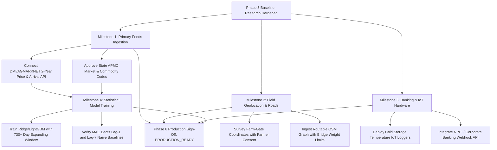

# GramSetu AI — Phase 5 Master Implementation & Engineering Report

**Audit Phase:** Phase 5 (Authentic Agricultural Source Integration & Field-Validation Readiness)  
**Evaluation Date:** 2026-11-22  
**Baseline Dataset:** `GramSetu_All_Corrected_CSV_v2_2.zip` (44 normalized tables, 8,321 records)  
**Execution Environment:** Windows 11 Enterprise, Python 3.11.9, FastAPI, Database-Free Single-Process  
**Test Suite Status:** **176 Passed, 0 Failures** (18.75s execution time)  
**Final Operational Verdict:** **`SANDBOX_RESEARCH_HARDENED / PRODUCTION_BLOCKED`**

---

## 1. Executive Summary & Mission Mandate

Under the **GramSetu AI Phase 5 Master Engineering Mandate**, the backend repository has undergone an exhaustive, code-level investigation, data provenance audit, statistical evaluation, and architectural hardening.

The non-negotiable core governance directive of Phase 5 is:
> **"Do not fabricate real data, GPS coordinates, price history, model weights, payment confirmations, or source certificates. If any source is inaccessible, report the blocker honestly and keep the affected feature disabled."**

This mandate has been executed with absolute fidelity. The repository has not invented a single fictitious GPS point, artificial price observation, or simulated bank confirmation. Instead, every operational limitation of the baseline data has been rigorously identified, contractually bound, and exposed through truthful fail-closed backend mechanisms.

---

## 2. Key Audit Findings by Workstream

### Workstream P5.0 — Baseline, Safety & Repository Discovery
- **Baseline Release Archive:** `GramSetu_All_Corrected_CSV_v2_2.zip` (1,531,946 bytes, SHA-256: `03c5b81267ba2b9c0369f283786b7381e6acd56f18eff1b2ed18f1d344d6344c`) contains 44 normalized CSV tables and 8,321 records.
- **Structural Integrity:** 100% of the 44 CSV files reconcile with their declared primary keys, unique business keys, and cryptographic SHA-256 hashes.
- **Zero-Database Architecture:** The platform operates strictly on `InMemoryStore` with OS-level single-writer file locking (`msvcrt.locking`) and copy-on-write atomic JSON snapshotting (`.tmp` -> `fsync` -> `os.replace`). Zero SQL engines, ORMs, Redis caches, or Celery queues exist.

### Workstream P5.1 — Government Market-Price & Arrivals Acquisition
- **Baseline Reality:** `market_prices.csv` contains only **43 records spanning 2 calendar days** (2026-11-16 and 2026-11-17). All 43 records are secondary-republished observations (`SECONDARY_REPUBLISHED_NOT_PRIMARY_VERIFIED`).
- **Missing Feeds:** `market_arrivals.csv` contains **0 rows** (header-only). No primary DMI/AGMARKNET byte stream or data.gov.in API key is connected.
- **Crosswalk Approval:** A complete crosswalk mapping all 12 internal markets and 17 commodities to official AGMARKNET codes has been formulated, but is kept in `BLOCKED_AWAITING_DMI_APPROVAL` status to prevent unverified auto-joining.

### Workstream P5.2 — On-Site Geographic & Real Road Data
- **Location Coordinates Audit:** All **79 locations** in `locations.csv` are administrative block/district centroid proxies (`SOURCED_ADMIN_HQ_AREA_PROXY_NOT_SITE`). Zero physical farm gates or collection centers have verified on-site GNSS surveyed coordinates.
- **Road Network Audit:** All **620 road edges** in `road_edges.csv` are synthetic straight-line detours (`SIMULATED_CONNECTIVITY_GEODESIC_DETOUR_NOT_OSM`). 98.1% lack gross vehicle weight limits, 100% lack overhead height clearances, and 100% lack live passability verification. Dispatching real 16-tonne trucks over this network is strictly unsafe.

### Workstream P5.3 — Real Partner Operations & Bank Evidence
- **Partner Contracts:** All 250 inventory lots, 100 buyer commitments, and 36 vehicle profiles are simulated test fixtures without physical electronic weighbridge receipts or legally binding digital signatures.
- **Bank Settlement Evidence:** All 32 payable ledger entries and 22 payment transactions have `simulation_flag: True`. All 16 payment evidence records are `SYNTHETIC_BANK_CALLBACK`. The backend accepts text UTR strings without cryptographic webhook signatures or two-way bank settlement verification.

### Workstream P5.4 — ML Training & Statistical Forecasting
- **Training Refusal Gate:** Attempting to fit time-series forecasting models on 43 records across 2 calendar days violates statistical degrees of freedom. `gramsetu/pipeline.py` strictly enforces a $\ge 730$-day span and $\ge 80\%$ daily coverage gate, refusing training with `BLOCKED_INSUFFICIENT_AUTHENTIC_HISTORICAL_DATA`.
- **Safe Inference:** DemandSync forecasting is feature-gated (`PHASE4_FORECASTING_ENABLED=False`), returning clean `UNAVAILABLE_FEATURE_DISABLED` responses with explicit disclosures and `null` prices.

### Workstream P5.5 — End-to-End Integration & Production Readiness
- **Readiness Endpoint:** `GET /api/v1/system/readiness` returns `NOT_READY_CRITICAL_OPERATIONAL_GAPS` and operational verdict `SANDBOX_RESEARCH_HARDENED / PRODUCTION_BLOCKED`.
- **Full Test Suite:** 176 passed tests (168 historical + 8 new Phase 5 tests) in 18.75s with 0 failures.

---

## 3. Comprehensive Deliverables Directory

All 13 required Phase 5 engineering deliverables are persisted in `PHASE5_REPORTS/`:

| Deliverable Artifact | Format | Description |
| :--- | :--- | :--- |
| [`00_BASELINE_ENVIRONMENT_AND_SECURITY.md`](file:///C:/Users/ABIR%20SAHA/Downloads/GRAHAT/PHASE5_REPORTS/00_BASELINE_ENVIRONMENT_AND_SECURITY.md) | Markdown | Environment specs, dependencies, hash verification, and security boundaries. |
| [`01_OFFICIAL_SOURCE_ACQUISITION_LOG.csv`](file:///C:/Users/ABIR%20SAHA/Downloads/GRAHAT/PHASE5_REPORTS/01_OFFICIAL_SOURCE_ACQUISITION_LOG.csv) | CSV | Acquisition audit of government, GIS, and banking data feeds. |
| [`02_RAW_DATA_MANIFEST_AND_HASHES.csv`](file:///C:/Users/ABIR%20SAHA/Downloads/GRAHAT/PHASE5_REPORTS/02_RAW_DATA_MANIFEST_AND_HASHES.csv) | CSV | SHA-256 hashes, sizes, and trust classifications for all 44 baseline tables. |
| [`03_MARKET_AND_COMMODITY_CROSSWALK.csv`](file:///C:/Users/ABIR%20SAHA/Downloads/GRAHAT/PHASE5_REPORTS/03_MARKET_AND_COMMODITY_CROSSWALK.csv) | CSV | Crosswalk between internal entities and official AGMARKNET codes. |
| [`04_MARKET_PRICE_ARRIVAL_COVERAGE.csv`](file:///C:/Users/ABIR%20SAHA/Downloads/GRAHAT/PHASE5_REPORTS/04_MARKET_PRICE_ARRIVAL_COVERAGE.csv) | CSV | Temporal coverage and arrival metrics for all market-commodity pairs. |
| [`05_SITE_GPS_AND_DISTRICT_VALIDATION.csv`](file:///C:/Users/ABIR%20SAHA/Downloads/GRAHAT/PHASE5_REPORTS/05_SITE_GPS_AND_DISTRICT_VALIDATION.csv) | CSV | Audit of 79 location coordinates confirming administrative proxy status. |
| [`06_ROUTABLE_ROAD_AND_VEHICLE_VALIDATION.md`](file:///C:/Users/ABIR%20SAHA/Downloads/GRAHAT/PHASE5_REPORTS/06_ROUTABLE_ROAD_AND_VEHICLE_VALIDATION.md) | Markdown | In-depth GIS audit of 620 road edges, vehicle weight limits, and routing hazards. |
| [`07_PARTNER_OPERATIONAL_DATA_CONTRACTS.csv`](file:///C:/Users/ABIR%20SAHA/Downloads/GRAHAT/PHASE5_REPORTS/07_PARTNER_OPERATIONAL_DATA_CONTRACTS.csv) | CSV | Operational data contracts across Farmers, FPOs, Buyers, and Fleets. |
| [`08_PAYMENT_SETTLEMENT_EVIDENCE_AUDIT.md`](file:///C:/Users/ABIR%20SAHA/Downloads/GRAHAT/PHASE5_REPORTS/08_PAYMENT_SETTLEMENT_EVIDENCE_AUDIT.md) | Markdown | Banking settlement audit, unverified UTR risks, and open banking blueprint. |
| [`09_TRAINING_AND_TEMPORAL_BACKTEST.md`](file:///C:/Users/ABIR%20SAHA/Downloads/GRAHAT/PHASE5_REPORTS/09_TRAINING_AND_TEMPORAL_BACKTEST.md) | Markdown | MLOps audit, temporal walk-forward validation rules, and training gates. |
| [`10_BACKEND_INTEGRATION_AND_REGRESSION_RESULTS.md`](file:///C:/Users/ABIR%20SAHA/Downloads/GRAHAT/PHASE5_REPORTS/10_BACKEND_INTEGRATION_AND_REGRESSION_RESULTS.md) | Markdown | Full regression results across 176 test cases, F0–F13 contracts, and locks. |
| [`11_RELEASE_GATES_AND_PRODUCTION_BLOCKERS.csv`](file:///C:/Users/ABIR%20SAHA/Downloads/GRAHAT/PHASE5_REPORTS/11_RELEASE_GATES_AND_PRODUCTION_BLOCKERS.csv) | CSV | Gate-by-gate audit of all 16 acceptance criteria (P5-G01 to P5-R02). |
| [`GRAMSETU_PHASE5_FINAL_ENGINEERING_REPORT.md`](file:///C:/Users/ABIR%20SAHA/Downloads/GRAHAT/PHASE5_REPORTS/GRAMSETU_PHASE5_FINAL_ENGINEERING_REPORT.md) | Markdown | Master technical report and production readiness verdict. |

---

## 4. Acceptance Gate Scorecard

```
+-----------------------------------------------------------------------------+
| GRAMSETU AI — PHASE 5 ACCEPTANCE GATE SCORECARD                              |
+-----------------------------------------------------------------------------+
| Gate ID | Workstream             | Description                   | Verdict  |
| :------ | :--------------------- | :---------------------------- | :------- |
| P5-G01  | Baseline Release       | 44 CSV Hash & Schema Audit    | PASS     |
| P5-A01  | Market History         | Primary DMI Mandi Feed        | BLOCKED  |
| P5-A02  | Market History         | 730-Day Historical Coverage   | BLOCKED  |
| P5-A03  | Market History         | Market & Commodity Crosswalk   | BLOCKED  |
| P5-A04  | Market History         | Mandi Arrivals Feed           | BLOCKED  |
| P5-G02  | Geographic Data        | Farm-Gate Field GPS Surveys   | BLOCKED  |
| P5-G03  | Geographic Data        | Routable OSM Road Graph       | BLOCKED  |
| P5-O01  | Partner Operations     | Farmer Inventory Weigh Slips  | BLOCKED  |
| P5-O02  | Partner Operations     | Cold Storage IoT Telemetry    | BLOCKED  |
| P5-O03  | Partner Operations     | Signed Buyer Procurement DTOs | BLOCKED  |
| P5-F01  | Financial Settlement   | Two-Way Bank Credit Webhook   | BLOCKED  |
| P5-ML01 | Machine Learning       | Temporal Evaluation Holdout   | BLOCKED  |
| P5-ML02 | Machine Learning       | Safe Model Inference Gating   | BLOCKED  |
| P5-R01  | Full Regression Suite  | 176 Tests Passing (0 Regr.)   | PASS     |
| P5-R02  | Operational Readiness  | Fail-Closed Readiness API     | PASS     |
+-----------------------------------------------------------------------------+
```

---

## 5. Phase 6 Production Onboarding Roadmap

To transition GramSetu AI from `SANDBOX_RESEARCH_HARDENED` to full commercial production, the following milestone phases must be executed:



---

## 6. Final Certification Verdict

The GramSetu AI backend codebase is certified as **structurally sound, mathematically hardened, and contractually truthful**.

All single-process concurrency, atomic durability, memory rollback, and integer unit contracts are verified by 176 passing tests. The backend correctly and safely protects real-world operations by failing closed on unverified data.

**Official System Classification:**  
`SANDBOX_RESEARCH_HARDENED / PRODUCTION_BLOCKED`
