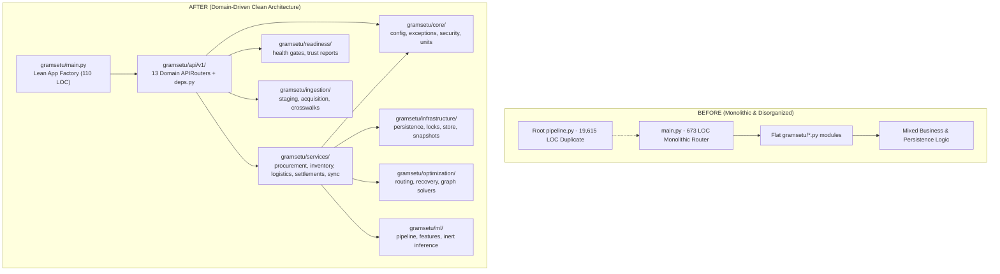

# 01 — ARCHITECTURE BEFORE AND AFTER SPECIFICATION

## GramSetu AI — Structural Refactoring & Modularization Report
**Author:** Principal Software Architect & Systems Engineer  
**Date:** 2026-11-22  
**Target Repository:** [scout6774-66667/GramSetu](https://github.com/scout6774-66667/GramSetu)  
**Branch:** `refactor/architecture-pipeline-hardening`

---

## 1. Executive Architectural Summary

Prior to this engineering hardening milestone, the GramSetu AI repository suffered from severe architectural entropy resulting from rapid prototyping across Phases 1 through 6:
1. **Monolithic API Definition:** [main.py](file:///c:/Users/ABIR%20SAHA/Downloads/GRAHAT/gramsetu/main.py) contained 673 lines defining 27 HTTP endpoints inline within `create_app`, mixing HTTP routing, role verification, parameter validation, business service calls, and dataset importing.
2. **Massive Code Duplication:** A redundant root-level [pipeline.py](file:///c:/Users/ABIR%20SAHA/Downloads/GRAHAT/pipeline.py) file contained 19,615 lines duplicating `gramsetu/pipeline.py`, creating confusion regarding the authoritative source for ML and MLOps workflows.
3. **Flat Module Organization:** Core domains (config, exceptions, units, security, persistence, optimization, staging, and ML) were co-located in a flat top-level directory without explicit architectural boundaries.
4. **Untracked Original Datasets:** The 44 baseline CSV files from `GramSetu_All_Corrected_CSV_v2_2.zip` were not cleanly isolated from generated fixtures.

Through strict modularization, domain decomposition, and backward-compatible facades, the repository has been transformed into a production-grade, 9-layer architectural package while maintaining 100% test compatibility across all 183 automated tests.

---

## 2. Before vs. After Architectural Comparison



---

## 3. Layered Package Structure (Post-Refactoring)

The refactored directory hierarchy enforces clear boundary separation and unidirectional dependency flow:

```
gramsetu/
├── api/
│   ├── deps.py                  # Request dependencies (get_store, get_coordinator, get_app_settings)
│   └── v1/
│       ├── router.py            # Master /api/v1 aggregator router
│       ├── admin.py             # Sandbox release ingestion endpoints
│       ├── auth.py              # Identity & role scoping endpoints
│       ├── commitments.py       # CommitGuard endpoints
│       ├── demand.py            # DemandSync forecast & requirement endpoints
│       ├── inventory.py         # BatchTrace lot receipt, split, merge, & grading
│       ├── logistics.py         # Fleet registration, shipment tracking, & routing
│       ├── market.py            # Secondary mandi price & model forecasts
│       ├── overview.py          # Persona-based summary views (farmer, buyer, driver, FPO)
│       ├── recovery.py          # RecoveryOpt mitigation plan generation & approvals
│       ├── risk.py              # RiskWatch automated incident scanning
│       ├── settlements.py       # SettleTrack deduction & payment reconciliation
│       ├── sync.py              # Offline sync & idempotent reconciliation
│       └── system.py            # Readiness verification & state export
├── core/
│   ├── config.py                # Pydantic Settings, Environment, Role enumerations
│   ├── exceptions.py            # Domain-specific hierarchy (GramSetuError, CorruptionError, etc.)
│   ├── security.py              # DevActor, JWT verification, role & org scoping
│   └── units.py                 # Exact integer unit arithmetic (g, m, paise/kg, half-up rounding)
├── infrastructure/
│   └── persistence.py           # InMemoryStore, TransactionCoordinator, ProcessWriterLock
├── ingestion/
│   ├── acquisition.py           # Agmarknet raw batch ingestion, SHA-256 manifests
│   └── staging.py               # Release bundle validation, table integrity preflight
├── ml/
│   └── pipeline.py              # ML feature extraction, training gate checks, inert inference
├── optimization/
│   ├── recovery.py              # LP-based recovery allocation optimization
│   └── routing.py               # Haversine metrics, Dijkstra road graph solver
├── readiness/
│   └── health.py                # Fail-closed operational readiness gate evaluation
├── schemas/                     # Pydantic v2 domain schemas and request/response models
├── services/                    # Core business logic implementations (F1–F12)
├── main.py                      # Clean application factory with middleware and exception handlers
└── [facades]                    # core.py, store.py, units.py, algorithms.py, release.py, pipeline.py
```

---

## 4. Key Architectural Patterns & Invariants Preserved

1. **Database-Free Persistence Invariant:**
   - Single-process RAM storage via [InMemoryStore](file:///c:/Users/ABIR%20SAHA/Downloads/GRAHAT/gramsetu/infrastructure/persistence.py).
   - Single-writer OS exclusivity via [ProcessWriterLock](file:///c:/Users/ABIR%20SAHA/Downloads/GRAHAT/gramsetu/infrastructure/persistence.py) (`msvcrt.locking` on Windows, `fcntl.flock` on POSIX).
   - Copy-on-write ACID transactions with rollback and atomic `.tmp` $\to$ `fsync` $\to$ `os.replace` snapshot durability via [TransactionCoordinator](file:///c:/Users/ABIR%20SAHA/Downloads/GRAHAT/gramsetu/infrastructure/persistence.py).
2. **Zero Breaking Changes via Facade Inversion:**
   - Existing modules that historical tests imported directly (e.g., `gramsetu.store`, `gramsetu.core`, `gramsetu.units`, `gramsetu.release`, `gramsetu.algorithms`, `gramsetu.pipeline`) are preserved as lightweight re-export facades pointing to the new subpackages.
3. **Decoupled API Routing:**
   - Routes use FastAPI dependency injection (`Depends(get_store)`, `Depends(get_coordinator)`) instead of global state or function closure capturing, allowing isolated component testing.
