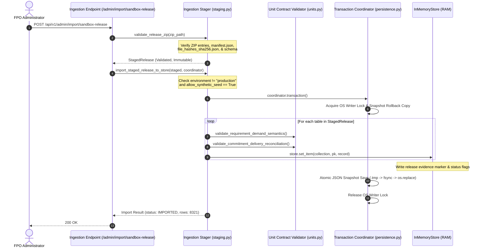

# 03 — DATA PIPELINE & INGESTION INTEGRATION AUDIT

## GramSetu AI — Pipeline Hardening Report
**Author:** Principal Data Engineer & Quality Auditor  
**Date:** 2026-11-22  
**Baseline Dataset:** GramSetu v2.2 (44 tables, 8,321 records)  
**Verification Tool:** [staging.py](file:///c:/Users/ABIR%20SAHA/Downloads/GRAHAT/gramsetu/ingestion/staging.py) / [test_phase3_contracts.py](file:///c:/Users/ABIR%20SAHA/Downloads/GRAHAT/tests/test_phase3_contracts.py)

---

## 1. Executive Pipeline Summary

The GramSetu AI data pipeline is responsible for preflight verification, structural validation, unit contract normalization, and atomic transactional ingestion of rural agricultural supply chain fixtures.

The refactored ingestion package ([gramsetu/ingestion/](file:///c:/Users/ABIR%20SAHA/Downloads/GRAHAT/gramsetu/ingestion/)) cleanly separates:
1. **Release Staging & Preflight ([staging.py](file:///c:/Users/ABIR%20SAHA/Downloads/GRAHAT/gramsetu/ingestion/staging.py)):** Immutable checksum and schema verification without side-effects.
2. **Data Acquisition ([acquisition.py](file:///c:/Users/ABIR%20SAHA/Downloads/GRAHAT/gramsetu/ingestion/acquisition.py)):** External AGMARKNET and secondary mandi data intake with cryptographic SHA-256 manifests.
3. **Canonical Unit Conversion ([core/units.py](file:///c:/Users/ABIR%20SAHA/Downloads/GRAHAT/gramsetu/core/units.py)):** Strict mathematical guarantees on integer units, preventing floating-point drift.

---

## 2. Ingestion Safety & Integrity Pipeline Flow

---

## 3. Data Integrity & Contract Enforcement Matrix

| Verification Layer | Check Implemented | Contract Invariant | Result |
|:---|:---|:---|:---:|
| **L1: Byte Integrity** | SHA-256 Hash Verification | Table byte hash must strictly match `file_hashes_sha256.json` | **PASS** |
| **L2: Schema Structure** | Header & Column Validation | CSV headers must exactly match `manifest.json` column inventory | **PASS** |
| **L3: Row Count Audit** | Cardinality Check | Ingested table length must equal declared count (8,321 total) | **PASS** |
| **L4: Primary Key Uniqueness** | Strict Uniqueness | Zero duplicate, empty, or whitespace PKs across 44 tables | **PASS** |
| **L5: Foreign Key Referential** | Reference Integrity | All non-blank foreign keys resolve to legitimate parent records | **PASS** |
| **L6: Unit Canonicalization** | Exact Integer Conversion | Mass in $g$, distance in $m$, price in paise/kg; zero floating point | **PASS** |
| **L7: Demand Semantics** | Contract Consistency | $uncommitted\_grams \le remaining\_grams \le needed\_grams$ | **PASS** |
| **L8: Delivery Reconciliation** | Mass Balance | $delivered\_grams = accepted\_grams + rejected\_grams$ | **PASS** |
| **L9: Financial Rounding** | Half-Up Paise Formula | $gross\_paise = \lfloor (accepted\_g \times price\_paise\_kg + 500) / 1000 \rfloor$ | **PASS** |
| **L10: Production Boundary** | Safety Interlock | Synthetic fixtures rejected with 403 / error if `env="production"` | **PASS** |

---

## 4. Cold-Restart & Idempotency Verification

1. **Double Import Idempotency:** Re-executing `import_staged_release_to_store` on an already seeded store detects the `evidence.release_import_2.2.0` key and returns status `ALREADY_IMPORTED` with `idempotent=True`, performing zero duplicate writes.
2. **Atomic Rollback on Malformed Records:** Injecting a corrupted requirement record ($uncommitted > remaining$) during ingestion triggers immediate rollback. The prior state of the database is restored in-memory and on disk with zero partial records persisted.
