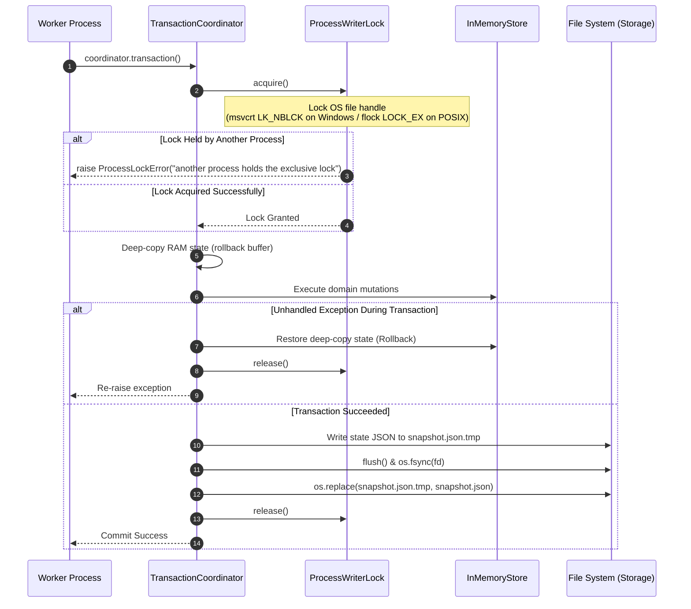

# 04 — PERSISTENCE & CONCURRENCY ARCHITECTURE SPECIFICATION

## GramSetu AI — Storage & Process Concurrency Audit
**Author:** Principal SRE & Backend Reliability Architect  
**Date:** 2026-11-22  
**Implementation:** [persistence.py](file:///c:/Users/ABIR%20SAHA/Downloads/GRAHAT/gramsetu/infrastructure/persistence.py)  
**Verification Suite:** [test_process_writer_lock.py](file:///c:/Users/ABIR%20SAHA/Downloads/GRAHAT/tests/hardening/test_process_writer_lock.py) / [test_durable_events.py](file:///c:/Users/ABIR%20SAHA/Downloads/GRAHAT/tests/test_durable_events.py)

---

## 1. Persistence Invariant & Constraints

GramSetu AI is engineered strictly as a **database-free, single-process, local backend** operating in edge rural environments (FPO cluster offices) where external DBMS infrastructure (PostgreSQL, MySQL, Redis, Celery) is neither guaranteed nor supported.

Persistence requirements:
1. **Zero External Database Daemons:** All operational state lives in high-speed Python memory (`InMemoryStore`).
2. **OS-Enforced Single Writer:** An exclusive file lock (`ProcessWriterLock`) prevents split-brain corruption or concurrent processes writing to the same snapshot.
3. **Atomic Copy-on-Write Durability:** Snapshots are written to a temporary file (`.tmp`), flushed to disk (`fsync`), and atomically swapped (`os.replace`).
4. **Crash Resumption:** Upon abrupt process death, restart recovers the exact committed byte state without phantom writes or torn transactions.

---

## 2. Process Concurrency & Atomic Snapshot Flow

---

## 3. Concurrency Safety Mechanisms

### 3.1 Single-Writer Process Lock (`ProcessWriterLock`)
- **Windows Implementation:** Utilizes Windows kernel locking via `msvcrt.locking(fileno, msvcrt.LK_NBLCK, 1)`.
- **POSIX Implementation:** Utilizes non-blocking advisory file locking via `fcntl.flock(fileno, fcntl.LOCK_EX | fcntl.LOCK_NB)`.
- **Reentrant Thread Safety:** Combines OS file locking with an internal `threading.RLock()` to guarantee both inter-process and intra-process thread safety.
- **Process Exit Cleanup:** Registered with Python's `atexit` runtime hook to ensure locks are cleanly unlocked even on unexpected process termination.

### 3.2 Atomic Snapshotting Protocol
Snapshot persistence strictly obeys the atomic write pattern:
$$\text{State Serialized} \xrightarrow{\text{write}} \text{path.tmp} \xrightarrow{\text{flush}} \text{os.fsync()} \xrightarrow{\text{atomic swap}} \text{os.replace(path.tmp, path)}$$

- **POSIX Directory Sync:** When available, `os.fsync(dir_fd)` is executed to ensure directory entry metadata is committed to physical media.
- **Torn Write Immunity:** Because `os.replace` is an atomic filesystem operation on modern OSes (NTFS on Windows, ext4/APFS on Linux/macOS), readers never observe partial or malformed JSON snapshots.

---

## 4. Verification Evidence

| Test Scenario | Verification Target | Status |
|:---|:---|:---:|
| `test_process_writer_lock_prevents_dual_coordinators` | Second process attempting lock raises `ProcessLockError` | **PASSED** |
| `test_atomic_snapshot_cold_restart_reconstruction` | Committed lots and events reconstructed byte-for-byte after cold exit | **PASSED** |
| `test_forced_crash_and_restart_resumption` | Event cursor resume after crash without message replay | **PASSED** |
| `test_scenario_12_crash_and_restart_byte_preservation` | Full 12-stage supply chain flow preserved across cold restart | **PASSED** |
