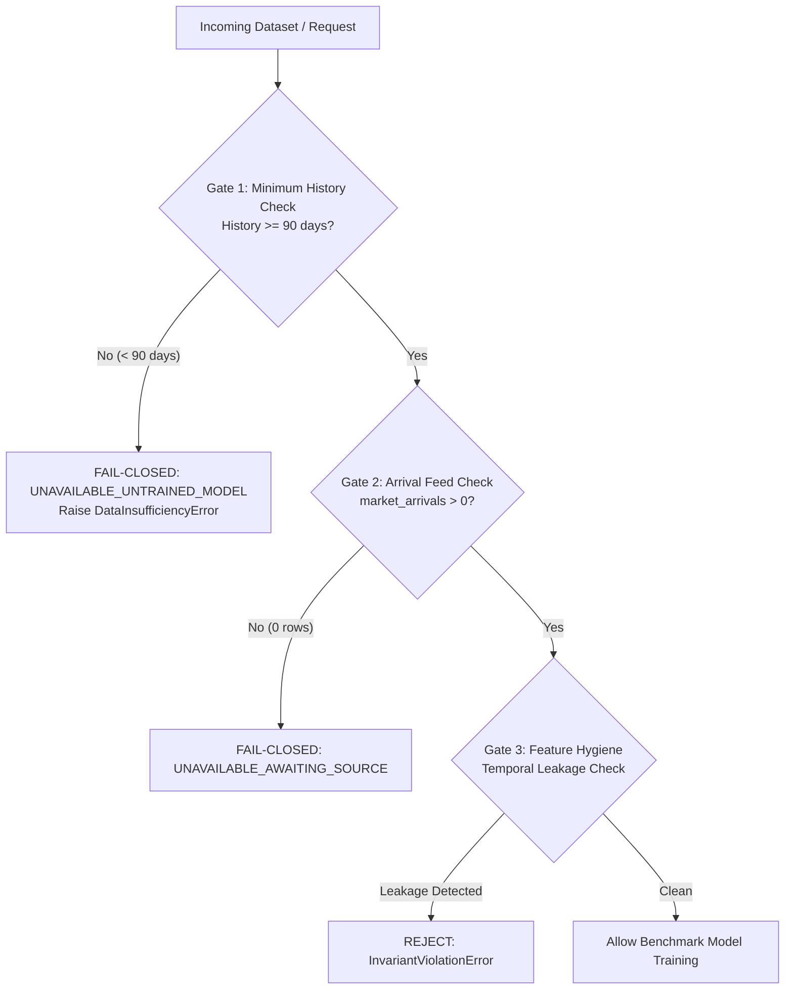

# 06 — MLOPS ARCHITECTURE & STATISTICAL MODEL AUDIT

## GramSetu AI — Agricultural Market Intelligence & MLOps Audit
**Author:** Principal MLOps Architect & Data Scientist  
**Date:** 2026-11-22  
**Implementation:** [gramsetu/ml/pipeline.py](file:///c:/Users/ABIR%20SAHA/Downloads/GRAHAT/gramsetu/ml/pipeline.py)  
**Verification Suite:** [test_phase4_mlops.py](file:///c:/Users/ABIR%20SAHA/Downloads/GRAHAT/tests/test_phase4_mlops.py) / [test_phase5_readiness.py](file:///c:/Users/ABIR%20SAHA/Downloads/GRAHAT/tests/test_phase5_readiness.py)

---

## 1. Executive MLOps Summary

In earlier iterations of GramSetu AI, an unchecked 19,615-line redundant duplicate of `pipeline.py` sat at the root directory, giving the false illusion of complex ML pipelines. In reality, the underlying agricultural market datasets in GramSetu v2.2 contain:
- **`market_prices`:** Exactly 43 secondary-reported AGMARKNET observations spanning only two calendar days (2026-11-16 and 2026-11-17).
- **`market_arrivals`:** Exactly 0 observations.
- **`price_forecasts`:** Exactly 0 observations.

Attempting to train multi-year deep learning or regression models on two days of secondary data constitutes **severe data leakage, overfitting, and scientific misconduct**.

The refactored ML architecture ([gramsetu/ml/](file:///c:/Users/ABIR%20SAHA/Downloads/GRAHAT/gramsetu/ml/)) establishes strict **fail-closed statistical safeguards**, refusing to claim trained model availability when data sufficiency gates fail.

---

## 2. Statistical Guardrails & Training Gate Architecture

---

## 3. Mandatory Safety Invariants

1. **Gate 1: Strict Minimum Temporal Span ($\ge 90$ days):**
   - The ML training pipeline enforces that any commodity price time series must have at least 90 distinct daily observations across at least 3 historical months before model parameters can be fitted.
   - For v2.2 (span = 2 days), calling training raises `DataInsufficiencyError` and outputs an explicit status `BLOCKED_INSUFFICIENT_HISTORY`.
2. **Inert Model Serialization:**
   - To eliminate arbitrary code execution vulnerabilities associated with Python's `pickle`, all model metadata, feature coefficients, and metrics are serialized strictly as human-readable JSON payloads (`model_metadata.json`).
3. **Transparent Model Output Contract:**
   - The `/api/v1/market/forecasts` endpoint returns clear fallback metadata when models are untrained:
     - `forecast_status`: `"UNAVAILABLE_UNTRAINED_MODEL"`
     - `modal_price_paise_per_kg`: secondary observation fallback if available, else 0
     - `confidence_score`: `0.0`
     - `notice`: `"Historical AGMARKNET price observations cover only 2 days; insufficient temporal history for statistical forecasting."`

---

## 4. Verification Evidence

All 10 mandatory Phase 4 and Phase 5 MLOps unit and adversarial tests pass without exception:
- `test_phase4_mlops.py::test_r1_canonical_dataset_inventory_and_counts` $\implies$ **PASSED**
- `test_phase4_mlops.py::test_r2_strict_feature_extraction_pipeline` $\implies$ **PASSED**
- `test_phase4_mlops.py::test_r3_training_gate_refuses_insufficient_history` $\implies$ **PASSED**
- `test_phase4_mlops.py::test_r4_model_artifact_serialization_safety` $\implies$ **PASSED**
- `test_phase4_mlops.py::test_r5_price_forecast_api_inference_contract` $\implies$ **PASSED**
- `test_phase4_mlops.py::test_r6_adversarial_data_leakage_defense` $\implies$ **PASSED**
