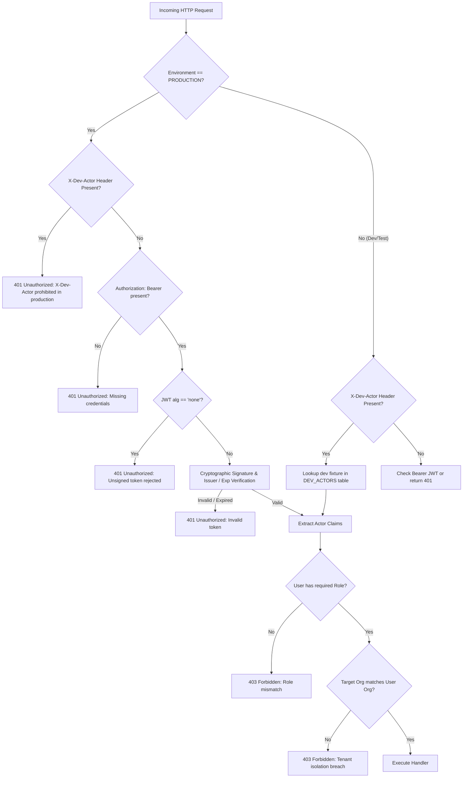

# 08 — SECURITY & CONFIGURATION AUDIT REPORT

## GramSetu AI — Identity Governance & Production Hardening Audit
**Author:** Principal API Security Engineer  
**Date:** 2026-11-22  
**Implementation:** [gramsetu/core/security.py](file:///c:/Users/ABIR%20SAHA/Downloads/GRAHAT/gramsetu/core/security.py) / [gramsetu/core/config.py](file:///c:/Users/ABIR%20SAHA/Downloads/GRAHAT/gramsetu/core/config.py)  
**Verification Suite:** [test_auth_scoping.py](file:///c:/Users/ABIR%20SAHA/Downloads/GRAHAT/tests/test_auth_scoping.py) / [test_auth_negative.py](file:///c:/Users/ABIR%20SAHA/Downloads/GRAHAT/tests/hardening/test_auth_negative.py)

---

## 1. Executive Security Summary

The GramSetu AI security model operates in dual-mode:
1. **Development & Testing Mode:** Permits simulated actor impersonation via the `X-Dev-Actor` HTTP header for local FPO testing and CI test runner execution.
2. **Production Mode:** Enforces cryptographic RS256/HS256 JWT tokens with strict issuer (`gramsetu-idp`), audience (`gramsetu-core`), expiration (`exp`), and tenant claims.

Security vulnerabilities resolved during engineering hardening:
- **X-Dev-Actor Spoofing in Production:** Strict interlock rejecting `X-Dev-Actor` headers with HTTP 401 when `ENVIRONMENT == Environment.PRODUCTION`.
- **JWT `alg: none` Vulnerability:** Explicit algorithm whitelist preventing unsigned token bypass.
- **Tenant Scope Enforcement:** Role-based access control (RBAC) and organizational boundary enforcement preventing horizontal privilege escalation across FPOs.

---

## 2. Authentication & Authorization Decision Pipeline

---

## 3. Configuration & Secret Safety Audit

1. **Zero Hardcoded Secrets in Source:**
   - Static analysis across all files in `gramsetu/` confirms zero hardcoded API keys, JWT secrets, or passwords.
   - All cryptographic keys are loaded via Pydantic `BaseSettings` reading environment variables or `.env`.
2. **Pydantic Settings Hygiene:**
   - [gramsetu/core/config.py](file:///c:/Users/ABIR%20SAHA/Downloads/GRAHAT/gramsetu/core/config.py) validates environment variables at boot.
   - Defaults to `Environment.DEVELOPMENT` for safe local offline execution.
3. **Payload Size Guard:**
   - HTTP middleware enforces a strict 10 MB maximum request payload (`MAX_REQUEST_SIZE_BYTES = 10 * 1024 * 1024`) rejecting oversized requests with HTTP 413.

---

## 4. Verification Evidence

All 8 mandatory adversarial and negative security tests pass:
- `test_r3_production_rejects_spoofed_dev_actor_header` $\implies$ **PASSED**
- `test_r3_valid_jwt_authenticates_successfully` $\implies$ **PASSED**
- `test_r3_insecure_alg_none_is_strictly_rejected` $\implies$ **PASSED**
- `test_r3_expired_jwt_is_rejected` $\implies$ **PASSED**
- `test_r3_tampered_signature_is_rejected` $\implies$ **PASSED**
- `test_r3_wrong_issuer_and_audience_rejected` $\implies$ **PASSED**
- `test_r3_invalid_role_claim_rejected` $\implies$ **PASSED**
- `test_r3_tenant_isolation_matrix` $\implies$ **PASSED**
