# 09 — CI/CD PIPELINE & AUTOMATED QUALITY GATES REPORT

## GramSetu AI — Continuous Integration Pipeline Specification
**Author:** Principal DevOps & SRE Engineer  
**Date:** 2026-11-22  
**Workflow File:** [.github/workflows/gramsetu-ci.yml](file:///c:/Users/ABIR%20SAHA/Downloads/GRAHAT/.github/workflows/gramsetu-ci.yml)

---

## 1. Executive CI/CD Summary

To prevent regressions, architectural erosion, and unauthorized data fabrication, a **9-Stage Automated Quality Gate** has been codified in GitHub Actions ([gramsetu-ci.yml](file:///c:/Users/ABIR%20SAHA/Downloads/GRAHAT/.github/workflows/gramsetu-ci.yml)).

Every pull request and push to `main` or release branches must sequentially pass all 9 stages before merge authorization.

---

## 2. The 9-Stage Automated Quality Gate Architecture

```mermaid
flowchart LR
    S1[1. Repo Structure Gate] --> S2[2. Code Quality & Lint]
    S2 --> S3[3. Secret Scan Gate]
    S3 --> S4[4. Domain Core & Unit Gate]
    S4 --> S5[5. Data Pipeline & Schema Gate]
    S5 --> S6[6. Integration & API Gate]
    S6 --> S7[7. Concurrency & Crash Gate]
    S7 --> S8[8. ML Safety & Leakage Gate]
    S8 --> S9[9. Package & Regression Gate]
```



---

## 3. Stage-by-Stage Specification

| Stage | Name | Target Verification | Tools & Commands |
|:---:|:---|:---|:---|
| **1** | **Repository Structure & Integrity** | Verifies modular folder layout (`core`, `infrastructure`, `ingestion`, `ml`, `api`, etc.) | Python structural verification script |
| **2** | **Code Quality & Static Analysis** | Enforces zero syntax errors, clean imports, and style consistency | `ruff check`, `py_compile` |
| **3** | **Security & Secret Scanning** | Prohibits hardcoded production credentials, private keys, or passwords | Regex-based AST and line scanner |
| **4** | **Domain Core & Unit Contracts** | Validates exact integer units, mass balance, and authorization scoping | `pytest tests/test_auth_scoping.py tests/hardening/test_auth_negative.py` |
| **5** | **Data Pipeline & Serialization** | Verifies 44-table CSV integrity, SHA-256 hashes, and demand semantics | `pytest tests/test_phase3_contracts.py VALIDATION_TESTS/` |
| **6** | **Integration & API Compatibility** | Exercises all 27 endpoints across the 8 functional business domains | `pytest tests/test_demandsync.py ... tests/test_settletrack.py` |
| **7** | **Concurrency & Crash-Safety** | Enforces `ProcessWriterLock` exclusivity and atomic snapshot recovery | `pytest tests/hardening/test_process_writer_lock.py ...` |
| **8** | **ML Safety & Data Leakage** | Enforces minimum temporal history gates and inert JSON model formats | `pytest tests/test_phase4_mlops.py tests/test_phase5_readiness.py` |
| **9** | **Package & Full Regression** | Verifies clean `pip install -e .` and passes all 183 automated tests | `pytest tests/ VALIDATION_TESTS/ -q` |

---

## 4. Local Execution & Reproducibility

Developers can replicate the exact GitHub Actions pipeline locally using the following shell command:
```bash
python -m pytest tests/ VALIDATION_TESTS/ -q
```
**Current Execution Performance:** 183 passed in **10.71 seconds** on Windows 11 Enterprise (Python 3.11.9).
