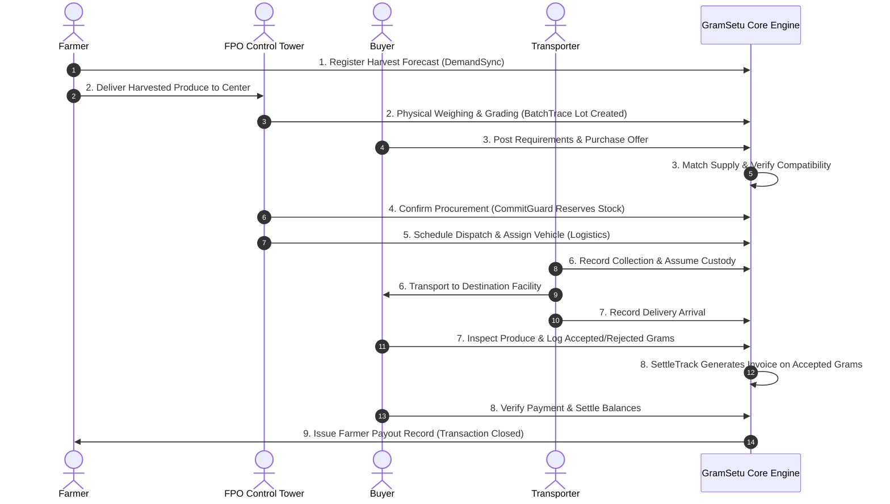
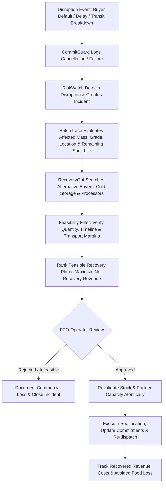

# GramSetu AI — Complete System Architecture
**Version 1.0 | Database-Free Backend Architecture | FastAPI + Python + JSON File Storage**

---

## 1. System Overview

**GramSetu AI** (*Intelligent Rural Food Supply Chain Resilience and Recovery System*) is a multi-user supply chain management platform designed to improve agricultural procurement reliability, reduce post-harvest losses, coordinate rural logistics, and manage supply chain disruptions.

The system connects four primary stakeholders:
1. **Farmers**: Smallholders and commercial producers registering anticipated harvests and tracking pickups/payouts.
2. **Farmer Producer Organizations (FPOs)**: Central operational coordinators managing collection centers, inventories, buyer contracts, logistics, and recovery plans.
3. **Agricultural Buyers**: Wholesale traders, processors, retailers, and institutional buyers submitting requirements, posting offers, and confirming receipts.
4. **Transport Operators**: Rural carriers, fleet managers, and individual vehicle drivers executing collection and delivery runs.

Unlike a conventional agricultural marketplace, GramSetu AI focuses on the **complete operational lifecycle** of agricultural produce, starting from expected harvesting and continuing through procurement, collection, transportation, delivery, quality verification, and payment settlement.

Its principal innovation is the **Supply Chain Risk Detection and Recovery Engine**, which identifies operational failures (e.g., buyer defaults, transit breakdowns, collection delays) and evaluates alternative actions before these failures result in avoidable economic losses or physical produce waste.

The system operates **database-free**, using an in-memory transactional state management engine backed by atomic copy-on-write JSON file snapshots and append-only event journals. All business logic is developed independently of storage implementations so that a transactional database (e.g., PostgreSQL + PostGIS) can be integrated later without rewriting core algorithms.

---

## 2. Architectural Approach

The backend follows a **Modular Monolithic Architecture**, structured around independent business domains. All backend modules operate inside a single FastAPI application while maintaining distinct responsibilities, service interfaces, schemas, and algorithm implementations.

### Key Advantages
- **Strong Consistency**: Guarantees zero phantom stock and transactional integrity between interconnected supply chain operations without distributed transaction overhead.
- **Simpler Development, Testing, and Debugging**: A unified code-level domain model avoids distributed race conditions and simplifies edge-case verification.
- **Pluggable Storage Abstraction**: Clean separation between domain algorithms, service coordinators, and storage repositories allows seamless future migration to persistent databases.

### Technology Stack
| Architectural Layer | Technology |
| :--- | :--- |
| **Backend Framework** | FastAPI (ASGI) |
| **Programming Language** | Python 3.11+ |
| **Request Validation** | Pydantic v2 |
| **Data Management** | In-memory transactional state (`InMemoryStore`) protected by `threading.RLock` |
| **Local Persistence** | Atomic JSON file snapshots (`.tmp` $\rightarrow$ `flush()` $\rightarrow$ `fsync()` $\rightarrow$ `os.replace()`) |
| **Algorithm Processing** | Python standard library, custom constraint logic, and heuristic graph search |
| **Optimization** | Deterministic heuristics; optional Google OR-Tools for advanced vehicle routing |
| **API Communication** | RESTful APIs (`/api/v1/` prefix) with standardized error envelopes |
| **Live Status Updates** | Polling initially; event stream ready |
| **Authentication / Identity** | Server-managed development identity adapter (`X-Dev-Actor`) with role & ownership scoping |
| **Testing** | Pytest, Starlette/HTTPX TestClient |
| **Configuration** | Pydantic Settings / Environment variables |
| **Future Database Migration** | PostgreSQL + PostGIS + SQLAlchemy / Alembic |

> [!IMPORTANT]
> **Single-Writer / Single-Process Constraint**: The combination of `threading.RLock` and atomic JSON file replacement is process-safe but **not multiprocess-safe**. The system is strictly designed to run as a single backend process (maximum 1 Uvicorn worker).

---

## 3. System Layers

GramSetu AI is organized into seven interconnected functional layers:

```
┌────────────────────────────────────────────────────────────────────────┐
│               Layer 1 — Application and Interface Layer                │
│    Farmer App   │   FPO Control Tower   │   Buyer App   │ Transporter  │
└───────────────────────────────────┬────────────────────────────────────┘
                                    │ HTTP REST (/api/v1/)
┌───────────────────────────────────▼────────────────────────────────────┐
│                Layer 2 — API and Communication Layer                   │
│   Request Validation │ Auth Scoping │ Error Envelope │ Idempotency Keys │
└───────────────────────────────────┬────────────────────────────────────┘
                                    │ Service Invocations
┌───────────────────────────────────▼────────────────────────────────────┐
│               Layer 3 — Core Business Logic Layer (Domains)            │
│   DemandSync   │  CommitGuard  │  BatchTrace  │  RiskWatch  │ Recovery │
│                │               │              │  SettleTrack│ Overview │
└─────────────┬─────────────────────┬─────────────────────┬──────────────┘
              │                     │                     │
┌─────────────▼─────────┐ ┌─────────▼─────────┐ ┌─────────▼──────────────┐
│  Layer 4 — Decision   │ │  Layer 5 — State  │ │   Layer 6 — Event &    │
│ Intelligence & Algos  │ │  & Persistence    │ │   Workflow Engine      │
│  - Demand Matching    │ │  - Transaction RLock│ - Outbox Journal       │
│  - Stock Allocation   │ │  - In-Memory State│ │ - Local Dispatcher     │
│  - Risk Scoring       │ │  - Atomic Snapshots│ - Poison Quarantine     │
│  - Recovery Optimizer │ │  - Deep-Copy Isolation - Idempotent Handlers │
└───────────────────────┘ └───────────────────┘ └────────────────────────┘
                                    │
┌───────────────────────────────────▼────────────────────────────────────┐
│           Layer 7 — Monitoring, Security and Performance Layer         │
│   Auditing │ Timing Benchmarks │ Invariant Guardrails │ Safe Defaults │
└────────────────────────────────────────────────────────────────────────┘
```

### Layer 1 — Application and Interface Layer
- **Farmer Application**: Access to harvest registrations, verified batch status, confirmed procurement terms, collection schedules, and payout statements.
- **FPO Control Tower**: The central operational nerve center. FPO operators manage farmer batches, weigh receipts, evaluate demand gaps, confirm buyer commitments, dispatch vehicles, resolve incidents, and approve recovery allocations.
- **Buyer Application**: Register purchasing requirements, post offers, sign off on commitments, monitor incoming shipments, inspect deliveries, and record accepted/rejected quantities.
- **Transporter Application**: View assigned collection runs, confirm pickup quantities, transfer custody, record GPS/delays, and submit delivery receipts.

### Layer 2 — API and Communication Layer
Controlled entry point for all frontend requests:
$$\text{Frontend Request} \longrightarrow \text{DevActor Auth} \longrightarrow \text{Role Scoping} \longrightarrow \text{Pydantic Validation} \longrightarrow \text{Domain Service} \longrightarrow \text{Atomic Transaction} \longrightarrow \text{Formatted Response}$$
Enforces versioning (`/api/v1/`), standard HTTP error envelopes (`{"error": {"code": ..., "message": ...}}`), and duplicate request suppression via `Idempotency-Key`.

### Layer 3 — Core Business Logic Layer
Encapsulates domain rules across 6 core subsystems:
1. **DemandSync**: Separates unverified harvest forecasts from verified physical stock. Computes crop/grade demand gaps.
2. **CommitGuard**: Coordinates buyer requirements, procurement offers, atomic stock reservations, and cancellation workflows.
3. **BatchTrace**: Manages verified physical lots, mass conservation during splits/merges, custody handoffs, and movement ledgering.
4. **RiskWatch**: Monitors operational lifecycles for delays, buyer withdrawals, transit disruptions, and produce spoilage. Generates actionable incidents.
5. **RecoveryOpt**: Re-evaluates stranded or disrupted inventory against registered alternative buyers, cold storages, and local processors.
6. **SettleTrack**: Calculates final payable sums from accepted quantities and agreed unit prices, tracks deductions, and records verified payout evidence.

### Layer 4 — Decision Intelligence and Algorithm Layer
Implements pure, unit-testable optimization and matching heuristics:
- **Supply–Demand Matching**: Matches grade, harvest dates, and geographical radiuses to identify net balances:
  $$\text{Demand Gap} = \text{Eligible Forecast Supply} - \text{Compatible Open Demand}$$
- **Inventory Allocation**: Atomically reserves stock from physical inventory:
  $$\text{Available Mass} = \text{Physical Mass} - \text{Reserved Mass} \ge \text{Requested Allocation}$$
- **Risk Severity Scoring**: Evaluates incident urgency using exposure, degradation curves, and lead times:
  $$\text{Exposure (Paise)} = \text{Affected Grams} \times \text{Agreed Unit Price}$$
- **Recovery Optimization**: Ranks candidate reallocations by net recovery margin:
  $$\max \left( \text{Expected Recovery Revenue} - \text{Incremental Recovery / Transport Costs} \right)$$
- **Logistics Route Estimation**: Computes great-circle distances, validates vehicle payload thresholds, and sequences multi-stop collections.

### Layer 5 — State Management and Persistence Layer
- **Repository Pattern**: Domain services interact only with abstract repository methods (`get_lot`, `save_lot`, `save_commitment`, etc.).
- **Transaction Coordinator**: Wraps state modifications inside `threading.RLock()`.
- **Atomic File Snapshots**: Serializes state to JSON, writes to a `.tmp` file, calls `os.fsync()`, and replaces canonical storage with `os.replace()`.
- **Deep-Copy Isolation**: All reads return independent deep copies to prevent caller side-effects from polluting authoritative memory.

### Layer 6 — Event Processing and Workflow Layer
- **Durable Outbox**: Mutations emit domain events (e.g., `harvest.registered`, `commitment.cancelled`, `pickup.failed`, `recovery.approved`) into an append-only event store.
- **Local Dispatcher**: Background worker processes pending events asynchronously without needing Celery or Redis.
- **Poison Event Quarantine**: Failing handlers retry up to 3 times before being quarantined as `POISON`, preventing head-of-line blocking.

### Layer 7 — Monitoring, Security and Performance Layer
- **Centralized Error Handling**: Transforms domain exceptions (`InsufficientStockException`, `ConcurrentModificationException`, `UnauthorizedActorException`) into deterministic HTTP status codes (400, 403, 404, 409).
- **Strict Data Types**: Produce mass in **integer grams**, currency in **integer paise**, and timestamps in **timezone-aware UTC ISO 8601**.
- **Audit Trails**: Every physical custody change, reservation, and financial payout creates an append-only ledger record.

---

## 4. Complete End-to-End System Workflow

The primary operational path tracks produce through nine coordinated stages:



1. **Harvest Planning**: Farmer registers expected crop, grade, quantity, and harvest dates.
2. **Supply Verification**: Produce arrives at the collection center; FPO verifies physical grams and grades. Physical `InventoryLot` is created.
3. **Procurement Matching**: System matches open requirements with available produce. Buyer issues a purchase offer.
4. **Inventory Reservation**: FPO confirms commitment. CommitGuard atomically reserves lot grams without moving physical goods.
5. **Logistics Planning**: FPO assigns vehicle and driver based on payload capacity and collection window.
6. **Collection & Custody**: Transporter confirms pickup. Custody transfers from FPO lot to active `Shipment`.
7. **Delivery Verification**: Buyer inspects delivered shipment, certifying accepted mass, rejected mass, or loss.
8. **Settlement Calculation**: SettleTrack computes net payable based exclusively on accepted grams $\times$ unit price, minus approved deductions.
9. **Transaction Completion**: Payment verification is recorded; farmer proceeds are allocated; transaction is archived.

---

## 5. Supply Chain Failure and Recovery Workflow

The failure and recovery engine is the core differentiator of GramSetu AI:



- **Step 1 — Capture the Failure**: CommitGuard records cancellation reason, preserving existing physical custody.
- **Step 2 — Detect the Risk**: RiskWatch generates an incident with urgency score, affected grams, and financial exposure.
- **Step 3 — Evaluate Produce Condition**: BatchTrace determines current location, custody holder, and maximum transit window.
- **Step 4 — Generate Recovery Candidates**: RecoveryOpt scans compatible buyers, cold stores, and processing units within range.
- **Step 5 — Validate Feasibility**: Evaluates vehicle load limits, delivery deadlines, and incremental freight costs.
- **Step 6 — Rank Options**: Sorts alternatives by net recovery value:
  $$\text{Net Value} = \text{Recovery Revenue} - \text{Additional Freight \& Handling}$$
- **Step 7 — Human Approval Required**: An FPO operator reviews recommendations. AI **never** commits commercial actions autonomously.
- **Step 8 — Revalidation & Execution**: State is re-checked against active stock. Only upon successful revalidation are new allocations committed.
- **Step 9 — Outcome Tracking**: System tracks actual delivered quantity, recovered revenue, and documented waste.

---

## 6. Data Consistency and Concurrency Architecture

### Strict Separation of Facts
To eliminate phantom inventory and financial ambiguity:
- **Forecast $\ne$ Physical Stock**: Forecasts carry zero physical inventory weight.
- **Physical Lot $\ne$ Reservation**: Reservations earmark mass; physical mass is reduced only upon verified collection.
- **Shipment $\ne$ Acceptance**: In-transit goods are in driver custody; ownership transfers to the buyer only upon signed delivery inspection.
- **Delivery $\ne$ Payment**: Delivery receipts record accepted mass; financial settlement is a separate, verified banking operation.

### Concurrency and Integrity Guardrails
1. **Optimistic Concurrency Control (OCC)**: Entities carry integer `version` numbers. Concurrent edits against stale versions fail with `409 Conflict`.
2. **Transactional Write Lock**: All state mutations acquire an internal `threading.RLock`, ensuring sequential write execution.
3. **Idempotent Retries**: Mutating requests accept `Idempotency-Key` headers. Duplicate requests return stored responses without repeating state changes.
4. **Conservation of Produce Mass**:
   $$\text{Available Grams} + \text{Reserved Grams} = \text{Total Lot Grams}$$
   $$\text{Delivered Grams} + \text{Discrepancy / Loss Grams} = \text{Picked Up Grams}$$

---

## 7. Backend Connections to Frontend Applications

| Backend Module | Farmer Application | FPO Control Tower | Buyer Application | Transporter Application |
| :--- | :--- | :--- | :--- | :--- |
| **DemandSync** | Register harvest forecasts | Review aggregate supply–demand gaps | Post procurement requirements | — |
| **CommitGuard** | View confirmed sales contracts | Confirm/cancel buyer purchase orders | Post purchase offers & sign agreements | — |
| **BatchTrace** | Track harvested batch status | Receipt, weigh, grade & split/merge lots | Review origin & quality certificates | Custody transfer at collection |
| **Logistics** | View scheduled farm pickup times | Assign vehicles, routes & collection runs | Monitor shipment delivery ETA | View route manifests & submit delivery receipts |
| **RiskWatch** | Receive collection delay alerts | Monitor operational incidents & alerts | Receive supply default notifications | Log transit breakdowns & roadblocks |
| **RecoveryOpt** | View revised buyer & collection terms | Evaluate & approve recovery allocations | Receive discounted emergency produce offers | Receive updated destination routing |
| **SettleTrack** | View payable balance & payouts | Reconcile invoices & authorize payouts | Review payable invoices & log payments | View freight settlement status |
| **Overview** | Farmer summary dashboard | Executive supply chain control dashboard | Buyer procurement dashboard | Driver assignment manifest |

---

## 8. API and Performance Architecture

### API Design Standards
- All endpoints are nested under `/api/v1/`.
- Standardized RESTful verbs (`POST` for commands, `GET` for queries).
- Consistent JSON error response format:
  ```json
  {
    "error": {
      "code": "INSUFFICIENT_AVAILABLE_STOCK",
      "message": "Requested 500,000g but only 200,000g available",
      "details": { "lot_id": "lot-123", "available_grams": 200000 }
    }
  }
  ```

### Performance Partitioning
- **Synchronous Operations**: Lightweight lookups, harvest registrations, inventory reservations, custody status updates, and basic settlement computations ($p95 < 5\text{ ms}$).
- **Asynchronous / Deferred Operations**: Route optimization, multi-candidate recovery planning, durable event outbox dispatch, and heavy analytics aggregations.
- **Offline Sync Resilience**: Mobile clients buffer mutations locally and sync via `/api/v1/sync/reconcile` using Last-Write-Wins (LWW) field resolution and tombstone deletion tracking.

---

## 9. Codebase Directory Architecture

The repository is structured as a clean, domain-separated modular monolith:

```
c:\Users\ABIR SAHA\Downloads\GRAHAT\
│
├── gramsetu/
│   ├── __init__.py
│   ├── main.py                  # FastAPI app factory, lifespan, routing, exception handlers
│   ├── core.py                  # Domain exceptions, security models, DevActor roles, config
│   ├── schemas.py               # Pydantic v2 schemas for all entities, requests, responses
│   ├── store.py                 # InMemoryStore, transaction lock, atomic JSON snapshots
│   ├── algorithms.py            # Pure heuristics: demand matching, route distances, recovery
│   ├── workers.py               # Local background thread for asynchronous event dispatching
│   │
│   └── services/
│       ├── __init__.py
│       ├── supply.py            # F2: Forecasts & farmer management
│       ├── inventory.py         # F3: BatchTrace lots, grading, splits/merges, movements
│       ├── procurement.py      # F4: DemandSync requirements & CommitGuard reservations
│       ├── logistics.py        # F5: Fleet, vehicle assignments, custody, receipts
│       ├── risk.py             # F6: RiskWatch rule evaluation & incident management
│       ├── recovery.py         # F7: RecoveryOpt candidate generation & approval
│       ├── settlement.py       # F8: SettleTrack invoice creation, deductions & payments
│       ├── overview.py         # F9: App-specific aggregated dashboard projections
│       ├── sync.py             # F10: Offline conflict reconciliation & tombstoning
│       └── events.py           # F11: Durable event outbox & poison queue quarantine
│
├── data/
│   └── state.json               # Canonical atomic JSON snapshot file (git-ignored)
│
├── docs/
│   ├── ARCHITECTURE.md          # Complete written architecture specification (this file)
│   ├── FEATURE_CONTRACTS.md     # Detailed contracts & invariants for F0–F13
│   ├── IMPLEMENTATION_PROGRESS.md # Continuous engineering tracker & loop log
│   └── openapi.json             # Static OpenAPI 3.1.0 schema export
│
├── scripts/
│   └── benchmark.py             # Performance benchmark measuring reads, routes & fsync
│
├── tests/
│   ├── conftest.py              # Pytest fixtures, test clients, fresh in-memory stores
│   ├── test_bootstrap.py        # F0: Storage durability & atomic file replacement
│   ├── test_auth_scoping.py     # F1: Role authorization & dev-actor enforcement
│   ├── test_demandsync.py       # F2: Forecasts & buyer requirement matching
│   ├── test_batchtrace.py       # F3: Physical lot ledger & mass conservation
│   ├── test_commitguard.py      # F4: Atomic procurement & reservation concurrency
│   ├── test_logistics.py        # F5: Vehicle capacity, driver custody & delivery
│   ├── test_riskwatch.py        # F6: Disruption detection & incident creation
│   ├── test_recoveryopt.py      # F7: Recovery candidate ranking & human approval
│   ├── test_settletrack.py      # F8: Accepted mass settlement & deduction accounting
│   ├── test_overview.py         # F9: Cross-app dashboard projections & metrics
│   ├── test_offline_sync.py     # F10: Offline LWW reconciliation & tombstone deletion
│   ├── test_durable_events.py   # F11: Event outbox & poison handler quarantine
│   ├── test_performance.py      # F12: Benchmarking & invariant stress testing
│   └── test_final_acceptance.py # F13: Complete harvest-to-payout simulation
│
├── pyproject.toml               # Poetry/pip build configuration & pytest parameters
├── .env.example                 # Environment variable templates
└── README.md                    # Project overview & quick-start guide
```

---

## 10. Backend Engineering Loop Sequence

The platform was constructed systematically following a test-driven, feature-by-feature verification loop across 14 sequential capabilities:

| Phase | Feature Name | Core Responsibility | Verification Focus |
| :---: | :--- | :--- | :--- |
| **F0** | Project Bootstrap | In-memory store, atomic JSON snapshot, error envelope | Cold restart persistence, fsync durability |
| **F1** | Identity & Auth | Dev-actor mapping, role scoping, resource isolation | Unauthorized access rejected with 401/403 |
| **F2** | DemandSync | Harvest forecasts & buyer requirements | Forecasts never increment physical stock |
| **F3** | BatchTrace | Physical lots, movements, splits, merges | Mass conservation, strictly non-negative stock |
| **F4** | CommitGuard | Procurement offers, atomic stock reservations | OCC collision prevention, double-booking lock |
| **F5** | Logistics | Vehicle fleets, driver custody handoffs, delivery | Overload prevention, verified delivery receipts |
| **F6** | RiskWatch | Disruption detection, spoilage curves, incidents | Automated incident creation on delays/cancellations |
| **F7** | RecoveryOpt | Recovery candidate search, ranking, FPO approval | AI advisory role; atomic revalidation before commit |
| **F8** | SettleTrack | Accepted quantity invoicing, deductions, payouts | Settlement strictly on accepted grams, not shipped |
| **F9** | Resilient Overview | Aggregated dashboard projections for all 4 roles | Fast read queries without full history recalculation |
| **F10**| Offline Sync | Mobile packet reconciliation, LWW, tombstones | Idempotent replay, conflict-free sync |
| **F11**| Durable Outbox | Event journal, background dispatch, poison queue | Zero lost events, poisoned handlers quarantined |
| **F12**| Performance Suite | Latency benchmarks, stress load, invariant checks | $p95 < 1\text{ ms}$ reads, $p95 < 50\text{ ms}$ disk writes |
| **F13**| Final Acceptance | End-to-end harvest-to-settlement lifecycle | Complete multi-actor workflow execution |

---

## 11. Architectural Limitations and Future Migration

While the database-free architecture provides extreme portability, sub-millisecond in-memory speeds, and zero infrastructure friction for edge deployments, it possesses defined constraints:
1. **Single-Process Constraint**: Cannot scale horizontally across multiple instances without a centralized database.
2. **Memory Footprint**: Working state is bounded by available system RAM.
3. **No Distributed Transactions**: Process termination during an unpersisted window relies on the durable event journal.

### Production Database Migration Blueprint
When migrating to enterprise production:
- Replace `InMemoryStore` with **PostgreSQL + PostGIS** using SQLAlchemy 2.0 or AsyncPG.
- Map the repository methods directly to SQL tables (`inventory_lots`, `commitments`, `shipments`, `settlements`) preserving the exact domain schemas.
- Replace local `threading.RLock` with SQL row-level locks (`SELECT ... FOR UPDATE`) or transactional isolation (`SERIALIZABLE`).
- Migrate the local event dispatcher to **Redis / Celery / RabbitMQ** for distributed outbox processing.
- Replace the development `X-Dev-Actor` adapter with **OIDC / JWT** authentication backed by an enterprise identity provider (Keycloak / Auth0).

Because all business rules, invariants, and algorithms are pure and decoupled from storage adapters, **zero domain logic will require rewriting** during database migration.

---

## 12. Final Architectural Summary

| Attribute | Foundation Specification |
| :--- | :--- |
| **Architecture Pattern** | Modular Monolith with Domain-Driven Subsystems |
| **Backend Framework** | FastAPI (Python 3.11+) |
| **Storage Engine** | In-Memory Transactional Store + Atomic JSON File Snapshots |
| **Core Business Domains** | 6 Interconnected Modules (DemandSync, CommitGuard, BatchTrace, RiskWatch, RecoveryOpt, SettleTrack) |
| **Decision Intelligence** | Constraint-based Supply Matching, Risk Scoring & Recovery Optimization |
| **Operational Control** | FPO Control Tower (Human-in-the-Loop Approval) |

### Core Architectural Principle
> **Every agricultural batch, procurement commitment, inventory movement, transport operation, incident, recovery decision, and payment record must be connected through a consistent and auditable operational workflow.**

GramSetu AI is organized around two essential execution cycles:
1. **Normal Supply Chain Cycle**:
   $$\text{Forecast} \longrightarrow \text{Physical Lot Verification} \longrightarrow \text{Commitment} \longrightarrow \text{Collection} \longrightarrow \text{Transport} \longrightarrow \text{Delivery Verification} \longrightarrow \text{Settlement}$$
2. **Disruption and Recovery Cycle**:
   $$\text{Risk Detection} \longrightarrow \text{Incident Creation} \longrightarrow \text{Feasibility Analysis} \longrightarrow \text{Recovery Optimization} \longrightarrow \text{Human Approval} \longrightarrow \text{Revalidation} \longrightarrow \text{Recovery Execution} \longrightarrow \text{Outcome Measurement}$$

These two cycles constitute the operational backbone of GramSetu AI. The backend is not merely a data store; it is the **authoritative arbiter of operational truth**, enforcing supply chain constraints, safeguarding food security, and protecting the economic livelihoods of rural agricultural producers.
