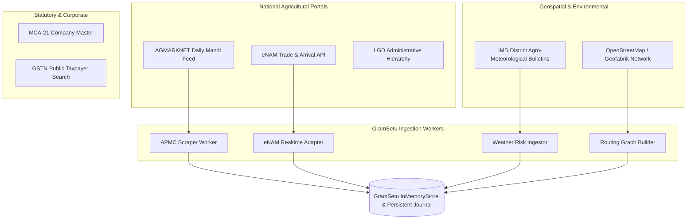

# GramSetu AI — Data Gap Register & Acquisition Roadmap

**Version**: 1.0.0  
**Status**: ACTIVE AUDIT REGISTER  
**Author**: Principal Data Engineer & Senior Backend Architect  

---

## 1. Overview & Gap Classification

During the comprehensive backend audit, several discrepancies between architectural aspirations (`docs/ARCHITECTURE.md`), database-free backend implementation (`gramsetu/`), and real-world agricultural data availability in India were identified.

Gaps are categorized into:
- **ARCH-GAP**: Features described in architectural design documents but unimplemented or stubbed in code.
- **DATA-GAP**: Fields required by domain logic where live automated feeds do not yet exist or rely on static ingestion.
- **SCHEMA-GAP**: Missing constraints or precision issues requiring data model extensions.

---

## 2. Identified Gap Register

| Gap ID | Category | Affected Domain | Description of Gap | Current Mitigation | Permanent Resolution Roadmap |
|---|---|---|---|---|---|
| **GAP-01** | **ARCH-GAP** | Market Intelligence Service | `ARCHITECTURE.md` (Component B) defines a `MarketIntelligenceService` providing daily APMC prices, modal trend analysis, and price elasticity. However, no service file exists in `gramsetu/services/` and no routes exist in `gramsetu/main.py`. | Seeded canonical APMC prices in `data/verified/daily_mandi_prices.csv` and ingested via `MandiPriceLoader`. | Implement `gramsetu/services/market_intel.py` exposing `/api/v1/market-intel/prices` and `/api/v1/market-intel/trends` with automated Agmarknet ETL sync. |
| **GAP-02** | **DATA-GAP** | Real-Time Weather & Hyperlocal IMD | Weather-induced crop damage and transit delay risks are modeled in `RiskWatchService` with static heuristic rules rather than live IMD radar/precipitation feeds. | Historical ambient temp and humidity thresholds stored in `crop_shelf_life_rules.csv`. | Integrate India Meteorological Department (IMD) Open Weather API or AWS Open Data AWS-IMD scraper with daily station sync based on LGD district codes. |
| **GAP-03** | **DATA-GAP** | Real-Time Road Closures & Traffic | `LogisticsService` uses static `speed_kmh` and manual `is_open` flags in `road_segments.csv`. Real-time flooding/landslide road blockages are not auto-streamed. | Operator updates `road_segments.csv` closure attributes or submits manual risk incident. | Connect OpenStreetMap Overpass API or State Highway Traffic Police RSS/Twitter disaster advisories to dynamically toggle `is_open` in `InMemoryStore`. |
| **GAP-04** | **SCHEMA-GAP** | KYC & GSTN Statutory Verification | Farmer Aadhaar/Land records and Buyer GSTIN are currently verified via boolean flags (`kyc_verified`, `credit_rating`) without real-time GSTN or Land Record API lookups. | Operator-confirmed CSV registries (`farmer_registry.csv`, `buyer_registry.csv`). | Integrate Sandpoint / Karza / Protean API gateway for automated GSTIN status verification and Land Record (Bhulekh / MahaBhulekh) 7/12 land parcel extraction. |
| **GAP-05** | **DATA-GAP** | Cold Storage Real-Time Telemetry | Cold storage facilities in `storage_facilities.csv` declare `temperature_controlled: True`, but lack IoT temperature/humidity sensor telemetry feeds to trigger spoilage alerts prior to shipment. | Risk engine assumes nominal optimal temperatures from `crop_shelf_life_rules.csv`. | Implement MQTT / Webhook IoT ingestion endpoint (`/api/v1/iot/telemetry`) accepting periodic temperature and humidity readings for warehouse lots. |
| **GAP-06** | **ARCH-GAP** | Dynamic Multi-Vehicle Fleet Routing (VRP) | `LogisticsService` currently evaluates single vehicle assignments and Dijkstra shortest paths, but does not solve capacitated vehicle routing (CVRP) across multiple farmer pickups in a single run. | 1:1 vehicle-to-lot shipment creation. | Introduce Google OR-Tools routing model (per architectural authorization) for multi-stop cluster pickup optimization. |

---

## 3. Real-World Data Source Acquisition Roadmap

To evolve GramSetu AI from static canonical datasets to live streaming data pipelines, the following ingestion workers are specified for Phase 2 implementation:

### 3.1 AGMARKNET Scraping & Automated Ingestion
- **Target URL**: `https://agmarknet.gov.in/SearchCmmMkt.aspx`
- **Methodology**: Scheduled nightly headless HTTP client (e.g. `httpx` + `selectolax`) fetching daily mandi prices for Maharashtra, Madhya Pradesh, and Karnataka.
- **Transformation**: Automatically convert reported `Rs/Quintal` to `paise_per_gram` ($\text{paise/g} = \text{Rs/Q} / 100$) with validation that $\text{min} \le \text{modal} \le \text{max}$.
- **Storage**: Append to verified time-series CSV journal.

### 3.2 OpenStreetMap (OSM) Graph Extraction
- **Target Source**: Geofabrik Maharashtra / Regional `.osm.pbf` extracts.
- **Methodology**: Use `osmnx` or `pyrosm` to extract primary, secondary, and tertiary road segments connecting registered FPO silos to major APMCs and terminal cities.
- **Transformation**: Assign rural road design speeds (25–50 km/h) and bridge weight limits. Compute segment distances via Haversine / geodesic geodesy.

### 3.3 IMD Agromet Advisory Integration
- **Target Source**: National Agromet Advisory Service (AAS) bulletins published bi-weekly by IMD (`https://imdagrimet.gov.in/`).
- **Methodology**: Automated parsing of rainfall forecasts, unseasonal precipitation alerts, and heatwave advisories mapped to district LGD codes.
- **Transformation**: Raise `WEATHER_ALERT` incidents in `RiskWatchService` when rainfall $\ge 50\text{mm}$ is forecasted during scheduled harvest windows.

---

## 4. Migration Requirements for PostgreSQL Transition

When transitioning from the database-free in-memory architecture to PostgreSQL:
1. **Schema Migration**:
   - `InMemoryStore` dictionary collections map 1:1 to normalized SQL tables.
   - All monetary fields retain integer `BIGINT paise` precision.
   - All mass fields retain integer `BIGINT grams` precision.
   - PostGIS extension required for spatial geometries (`road_nodes`, `road_segments`, facility polygons).
2. **Transaction Isolation**:
   - The current single-writer `threading.RLock` and copy-on-write snapshot mechanism must be replaced with PostgreSQL `SERIALIZABLE` or `REPEATABLE READ` transaction isolation with row-level locks on inventory lots (`SELECT FOR UPDATE`) during commitment reservations.
