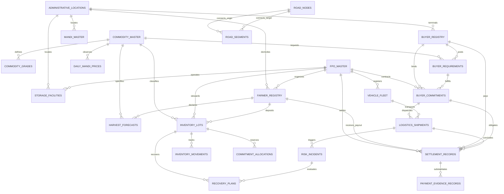

# GramSetu AI — Canonical Entity-Relationship Model & Data Architecture

**Specification Version**: 2.0-DataEng  
**Storage Model**: Zero-Database Relational Mapping over In-Memory Dicts (`InMemoryStore`) + JSON Journal  
**Key Standards**: UUIDv4 primary keys with functional prefixes (`fc-`, `lot-`, `mov-`, `req-`, `com-`, `ship-`, `inc-`, `rec-`, `set-`, `evi-`), ISO 8601 UTC timestamps, integer grams, integer paise.

---

## 1. Entity-Relationship Diagram

---

## 2. Relational Schema & Cardinality Specifications

### Core Master Entities
1. **`COMMODITY_MASTER`** (`commodity_id` [PK]):
   - Zero or many `COMMODITY_GRADES` (1:N)
   - Zero or many `HARVEST_FORECASTS` (1:N)
   - Zero or many `INVENTORY_LOTS` (1:N)
   - Zero or many `BUYER_REQUIREMENTS` (1:N)
2. **`ADMINISTRATIVE_LOCATIONS`** (`location_id` [PK], `lgd_code` [UQ]):
   - Zero or many `MANDI_MASTER` (1:N)
   - Zero or many `STORAGE_FACILITIES` (1:N)
   - Zero or many `FARMER_REGISTRY` (1:N)
   - Zero or many `BUYER_REGISTRY` (1:N)
3. **`FPO_MASTER`** (`fpo_id` [PK], `cin_registration_no` [UQ]):
   - One or many `FARMER_REGISTRY` members (1:N)
   - One or many `STORAGE_FACILITIES` (1:N)
   - Zero or many `VEHICLE_FLEET` (1:N)
   - Zero or many `INVENTORY_LOTS` (1:N)
   - Zero or many `BUYER_COMMITMENTS` (1:N)

### Operational Supply & Traceability Entities
4. **`FARMER_REGISTRY`** (`farmer_id` [PK]):
   - Belongs to exactly one `FPO_MASTER` (N:1)
   - Domiciled in exactly one `ADMINISTRATIVE_LOCATIONS` (N:1)
   - Emits zero or many `HARVEST_FORECASTS` (1:N)
   - Deposits zero or many `INVENTORY_LOTS` (1:N)
5. **`INVENTORY_LOTS`** (`lot_id` [PK]):
   - Deposited by exactly one `FARMER_REGISTRY` (N:1)
   - Owned and managed by exactly one `FPO_MASTER` (N:1)
   - Stored in exactly one `STORAGE_FACILITIES` (N:1)
   - Produces one or many `INVENTORY_MOVEMENTS` (1:N)
   - Allocated across zero or many `BUYER_COMMITMENTS` (1:N)
   - **Mass Invariant**: $\text{quantity\_grams} = \text{available\_grams} + \text{reserved\_grams}$
6. **`INVENTORY_MOVEMENTS`** (`movement_id` [PK]):
   - Immutable audit record referencing parent `INVENTORY_LOTS` (N:1)
   - Tracks custody changes (`FPO_WAREHOUSE` $\rightarrow$ `DRIVER_CUSTODY` $\rightarrow$ `BUYER_ACCEPTED`)

### Procurement & Fulfillment Entities
7. **`BUYER_REGISTRY`** (`buyer_id` [PK], `gstin` [UQ]):
   - Posts zero or many `BUYER_REQUIREMENTS` (1:N)
   - Enters zero or many `BUYER_COMMITMENTS` (1:N)
   - Obligated on zero or many `SETTLEMENT_RECORDS` (1:N)
8. **`BUYER_REQUIREMENTS`** (`requirement_id` [PK]):
   - Posted by exactly one `BUYER_REGISTRY` (N:1)
   - Satisfied by zero or many `BUYER_COMMITMENTS` (1:N)
   - **Capacity Invariant**: $\text{allocated\_grams} \le \text{needed\_grams}$
9. **`BUYER_COMMITMENTS`** (`commitment_id` [PK]):
   - References parent `BUYER_REQUIREMENTS` (N:1)
   - Locks inventory across one or many `INVENTORY_LOTS` via allocations JSON
   - Dispatched across zero or one `LOGISTICS_SHIPMENTS` (1:1)
   - Generates exactly one `SETTLEMENT_RECORDS` post-delivery (1:1)

### Logistics, Risk & Settlement Entities
10. **`LOGISTICS_SHIPMENTS`** (`shipment_id` [PK]):
    - Binds `BUYER_COMMITMENTS` to `VEHICLE_FLEET` and assigned driver (N:1)
    - Emits dispatch and delivery confirmations
    - **Conservation Invariant**: $\text{accepted\_grams} + \text{rejected\_grams} + \text{loss\_grams} == \text{dispatched\_grams}$
11. **`RISK_INCIDENTS`** (`incident_id` [PK], `dedup_key` [UQ]):
    - Evaluates disruptions on shipments, lots, or commitments
    - Triggers zero or one `RECOVERY_PLANS` (1:1)
12. **`RECOVERY_PLANS`** (`plan_id` [PK]):
    - Formulated for exactly one `RISK_INCIDENTS` (N:1)
    - Reallocates distressed produce across candidate buyer requirements
13. **`SETTLEMENT_RECORDS`** (`settlement_id` [PK]):
    - Generated from delivered `LOGISTICS_SHIPMENTS` (1:1)
    - **Monetary Invariant**: $\text{gross\_paise} - \text{total\_deductions\_paise} == \text{net\_payable\_paise}$
    - **Balance Invariant**: $\text{remaining\_balance\_paise} == \text{net\_payable\_paise} - \text{paid\_amount\_paise}$
14. **`PAYMENT_EVIDENCE_RECORDS`** (`evidence_id` [PK], `raw_reference` [UQ]):
    - Substantiates payments and weighbridge receipts via immutable SHA-256 payload digests

---

## 3. Data Ownership & Governance Matrix

| Entity Group | Producing Authority | Primary Writer | Read Access | Mutability Policy | Retention Policy |
|---|---|---|---|---|---|
| **Commodity Master & Standards** | National Standards (BIS/AGMARK) | Backend Data Engineer | All Roles | Versioned Master; Updates via Migration | Permanent |
| **Mandi & Market Intelligence** | Ministry of Agriculture (Agmarknet) | Automated Ingestion Pipeline | All Roles | Immutable Daily Observations; Append-only | 5+ Years Historical |
| **Administrative & GIS Geography** | Survey of India / LGD / OSM | GIS Engineer | All Roles | Versioned Master; Biannual Sync | Permanent |
| **Farmer Registry & Landholdings** | Farmer / State Revenue Portal | Farmer & FPO Admin | Farmer, FPO Admin, System | Semi-static; Updates on acreage changes | Active Membership |
| **Physical Inventory Lots** | FPO Warehouse Operator | FPO Admin | FPO Admin, System | Transactional; Mass conservation enforced | Retained post-delivery |
| **Inventory Movements** | Physical Custody Transfer | Backend Coordinator | FPO Admin, Auditor, System | **Strictly Immutable / Append-only** | Permanent Audit |
| **Buyer Demands & Requirements** | Commercial Buyer | Buyer | All Roles (Public Market) | Dynamic; Cancellable before commitment | 1 Year |
| **Buyer Commitments** | Bilateral Contract (Buyer + FPO) | Buyer & FPO Admin | Buyer, FPO Admin, Driver | Locked once active; Release via cancellation | 7 Years (Statutory) |
| **Shipments & Logistics Custody** | Transporter / Driver | Driver & FPO Admin | Buyer, FPO Admin, Driver | State machine (`SCHEDULED` $\rightarrow$ `DRIVER` $\rightarrow$ `BUYER`) | 7 Years |
| **Risk Incidents & Alarms** | Algorithmic Risk Scanner | Risk Engine / System | FPO Admin, System | State machine (`OPEN` $\rightarrow$ `ACK` $\rightarrow$ `RESOLVED`) | 3 Years |
| **Recovery Plans & Decisions** | Combinatorial Recovery Optimizer | System & FPO Admin | FPO Admin, Buyer | Immutable once approved | 3 Years |
| **Financial Settlements** | Accounting Ledger | FPO Admin & System | Farmer, Buyer, FPO Admin | Closed once balance reaches zero | 8 Years (Tax/Audit) |
| **Payment Evidence & Proofs** | Banks / Certified Weighbridges | EvidenceManager / Banks | All Involved Parties | **Strictly Immutable / Append-only** | Permanent Audit |
